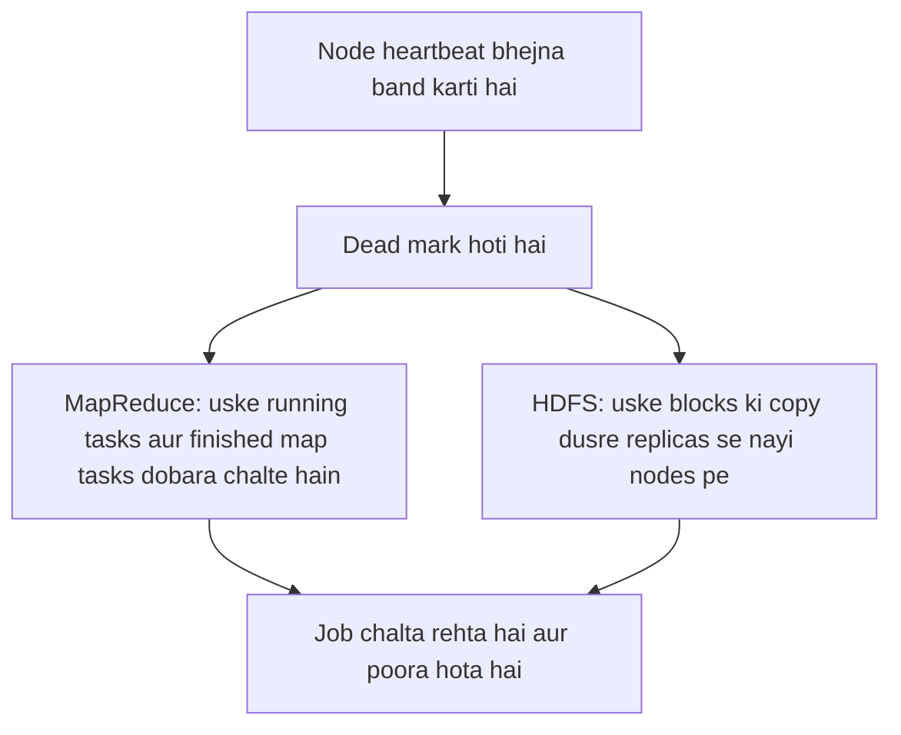

**In simple words:** Hadoop cluster mein sainkdon sasti machines hoti hain, isliye koi na koi node hamesha fail hota rehta hai. Hadoop failure ko normal maanta hai. **HDFS** data ki copies rakhta hai, aur **MapReduce/YARN** khoya hua kaam kisi dusri node pe dobara chalata hai, to user ka job phir bhi poora ho jata hai. <Cite id="hdfs-apache-design" /> <Cite id="hadoop-ecosystem-dean2004" loc="§3.3" />

<Cite id="hdfs-gfg" loc="diagram" />

1. **Detection.** Har DataNode aur worker **heartbeat** bhejta hai (HDFS mein har 3 second). Agar timeout tak heartbeat band rahe (DataNode ke liye default se 10 minute se zyada), to node dead mark hoti hai. <Cite id="hdfs-apache-design" />
2. **DataNode failure (HDFS).** Har block ke default 3 replicas alag nodes aur racks pe hote hain. Node marne par NameNode wo blocks dhoondhta hai jinki copies 3 se kam ho gayi, aur dusri nodes pe nayi copies banwata hai. Data lose nahi hota.
3. **Task aur worker failure (MapReduce).** Fail hua map ya reduce task dusri node pe dobara chalta hai (default 4 attempts). Dead node ke finished **map** tasks bhi dobara chalte hain, kyunki unka output uski local disk pe tha. Finished **reduce** output pehle se HDFS mein hai. <Cite id="mapreduce-apache-mapred-default" />
4. **Slow node.** Straggler ke task ki backup copy chalti hai (speculative execution); jo pehle khatam kare wahi jeetta hai.
5. **NameNode failure.** NameNode single point of failure hai jab tak **High Availability** set na ho: Standby NameNode Active ki jagah le leta hai. Secondary NameNode backup nahi hai. <Cite id="hdfs-apache-ha" />

| Fail hone wali node | Hadoop kya karta hai |
|---|---|
| DataNode | Uske blocks ko dusri copies se re-replicate karta hai |
| Worker (NodeManager) | Uske tasks dusri jagah dobara chalata hai |
| NameNode | Standby NameNode le leta hai (HA) |

**Conclusion:** replication data ko bachata hai aur task re-execution computation ko, isliye node failure se job sirf thoda slow hota hai.

Exam mein English mein likho: "Hadoop handles node failure through heartbeats, block replication in HDFS and re-execution of tasks in MapReduce."
