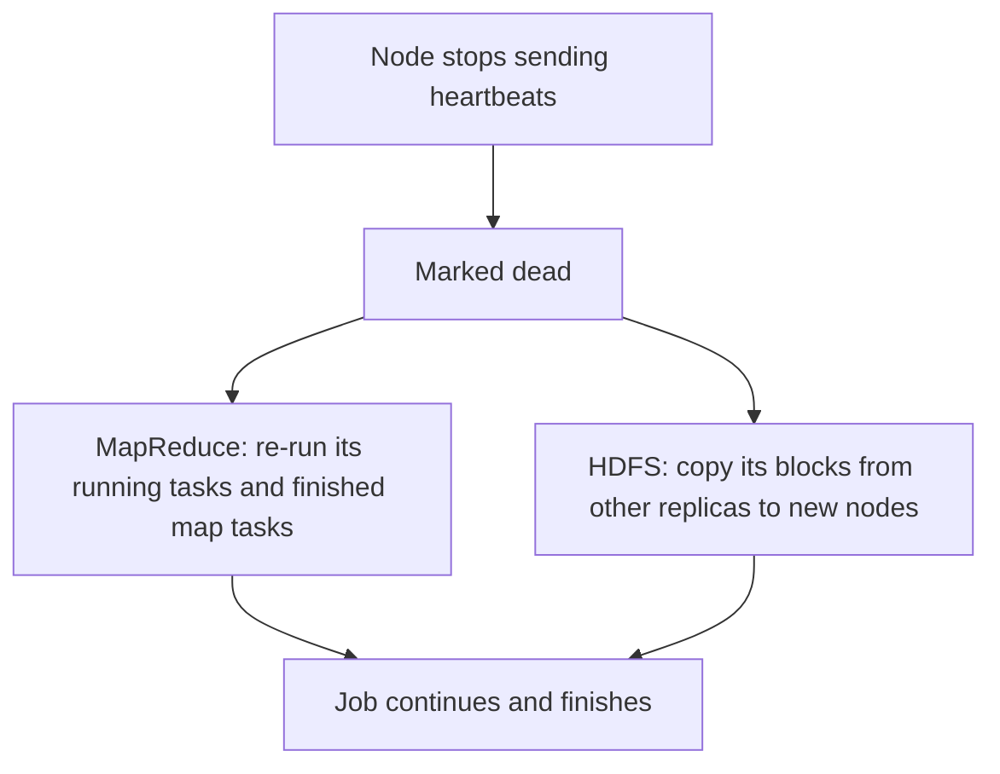

**In simple words:** a Hadoop cluster has hundreds of cheap machines, so some node is always failing. Hadoop treats failure as normal. **HDFS** keeps copies of the data, and **MapReduce/YARN** re-runs the lost work on another node, so the user's job still finishes. <Cite id="hdfs-apache-design" /> <Cite id="hadoop-ecosystem-dean2004" loc="§3.3" />

<Cite id="hdfs-gfg" loc="diagram" />

1. **Detection.** Every DataNode and worker sends a **heartbeat** (every 3 seconds in HDFS). If heartbeats stop for the timeout (over 10 minutes by default for a DataNode), the node is marked dead. <Cite id="hdfs-apache-design" />
2. **DataNode failure (HDFS).** Each block has 3 replicas by default, placed on different nodes and racks. When a node dies, the NameNode finds the blocks that now have fewer than 3 copies and orders new copies on other nodes. No data is lost.
3. **Task and worker failure (MapReduce).** A failed map or reduce task is re-run on another node (4 attempts by default). Finished **map** tasks of the dead node are also re-run, because their output was on its local disk. Finished **reduce** output is already in HDFS. <Cite id="mapreduce-apache-mapred-default" />
4. **Slow node.** A straggler gets a backup copy of its task (speculative execution); the first to finish wins.
5. **NameNode failure.** The NameNode is a single point of failure unless **High Availability** is set up: a Standby NameNode takes over from the Active one. The Secondary NameNode is not a backup. <Cite id="hdfs-apache-ha" />

| Node that fails | What Hadoop does |
|---|---|
| DataNode | Re-replicate its blocks from other copies |
| Worker (NodeManager) | Re-run its tasks elsewhere |
| NameNode | Standby NameNode takes over (HA) |

**Conclusion:** replication protects the data and task re-execution protects the computation, so a node failure only slows a job down.
