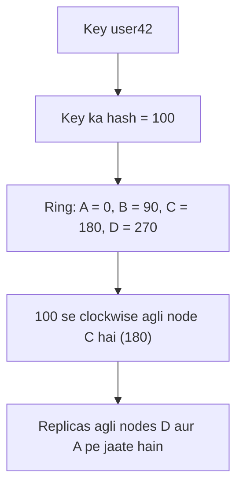

**In simple words:** jab data aur traffic bahut bade ho jate hain to ek relational server toot jata hai. McCreary aur Kelly **chaar tarike** batate hain jinse NoSQL systems big data problems handle karte hain: (1) query ko data ke paas le jao, (2) hash rings se data evenly baanto, (3) replication se reads scale karo, aur (4) database queries ko data nodes mein evenly distribute kare. Chaaron bahut saari sasti machines pe depend karte hain jo kuch share nahi karti (scale-out). <Cite id="big-data-intro-nosql" /> <Cite id="nosql-intro-gfg-intro" />

**Ye kyun zaroori hai:** ek bada server mehnga hai, uski limit hai, aur wo single point of failure hai. NoSQL data aur kaam ko bahut saari nodes pe failata hai.

1. **Query ko data ke paas le jao, data ko query ke paas nahi.** Terabytes ko network pe bhejna slow hai. Isliye chhoti query ko har node pe bhejo, wo apne local data mein search kare aur sirf chhote answers wapas de. MapReduce yahi karta hai, har task us node pe chalta hai jahan block store hai. *Analogy: saare students ko ek hall mein bulane ke bajay har school mein ek teacher bhejo.*
2. **Data ko evenly baantne ke liye hash rings.** Hash function key ko number banata hai. Numbers ek circle mein rakhe jate hain aur har node circle ka ek hissa own karti hai. Key us node pe store hoti hai jo uski hash value se clockwise pehle milti hai. Node judne ya jaane par data ka sirf chhota hissa move hota hai. <Cite id="nosql-intro-dynamo" />
3. **Reads scale karne ke liye replication.** Har data ki kai copies alag nodes pe rakho. Read kisi bhi copy se ho sakti hai, to zyada copies matlab zyada reads per second. Copies node failure se bhi bachati hain. <Cite id="nosql-intro-mongo-repl" />
4. **Database queries ko data nodes mein evenly distribute kare.** Router ya nodes khud har request ko aisi node pe bhejti hain jisme data ho aur jo busy na ho, to koi node hot spot nahi banti. <Cite id="nosql-intro-mongo-shard" />

<Cite id="nosql-intro-dynamo" loc="diagram" />

**Ring kyun, `hash mod N` kyun nahi:** `hash mod N` mein nodes ki sankhya $N$ badalne par lagbhag har key move hoti hai. Ring mein sirf naye node ke just pehle ki keys move hoti hain. Jaise 150 pe node E add karne par sirf hash 91 se 150 wali keys jati hain, jo pehle C ki thi.

| Problem | NoSQL ka jawab | Example system |
|---|---|---|
| Bada data move karna slow hai | Query ko data ke paas le jao | MapReduce, HBase |
| Uneven load aur growth | Hash ring data evenly baantti hai | Dynamo, Cassandra |
| Bahut reads, node failure | Replication | MongoDB replica set |
| Hot spots | Queries evenly distribute karo | MongoDB sharding router |

**Limitation:** copies thodi der ke liye out of date ho sakti hain (eventual consistency), aur nodes ke beech joins mushkil hain.

**Conclusion:** in ideas se NoSQL systems sasti nodes jod kar grow karte hain, bahut users serve karte hain aur failures survive karte hain.

Exam mein English mein likho: "NoSQL handles big data by moving the query to the data, distributing data evenly with hash rings, scaling reads with replication, and distributing queries evenly across the data nodes."
