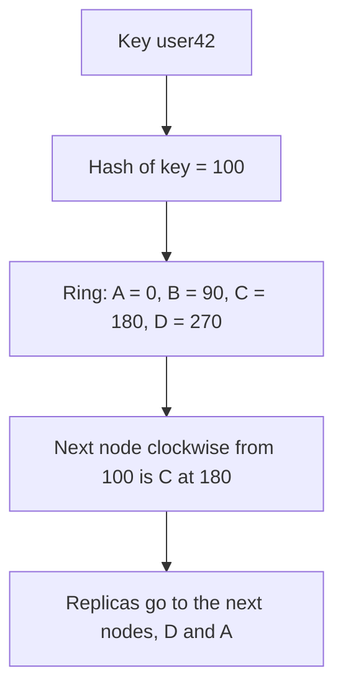

**In simple words:** a single relational server breaks down when data and traffic grow very large. McCreary and Kelly describe **four ways** in which NoSQL systems handle big data problems: (1) move the query to the data, (2) use hash rings to spread data evenly, (3) use replication to scale reads, and (4) let the database distribute queries evenly across the data nodes. All four rely on many cheap machines that share nothing (scale-out). <Cite id="big-data-intro-nosql" /> <Cite id="nosql-intro-gfg-intro" />

**Why it is needed:** one big server is costly, has a limit, and is a single point of failure. NoSQL spreads data and work over many nodes instead.

1. **Move the query to the data, not the data to the query.** Moving terabytes over the network is slow. Instead send the small query to each node, let it search its own local data and return only the small answers. MapReduce does this by running each task on the node that stores the block. *Analogy: send one teacher to each school instead of bringing all students to one hall.*
2. **Use hash rings to distribute data evenly.** A hash function turns a key into a number. The numbers are arranged on a circle, and each node owns a part of it. A key is stored on the first node found going clockwise from its hash value. When a node joins or leaves, only a small part of the data moves. <Cite id="nosql-intro-dynamo" />
3. **Use replication to scale reads.** Keep several copies of each piece of data on different nodes. A read can go to any copy, so more copies mean more reads per second. Copies also protect against node failure. <Cite id="nosql-intro-mongo-repl" />
4. **Let the database distribute queries evenly to the data nodes.** A router, or the nodes themselves, send each request to a node that holds the data and is not busy, so no node becomes a hot spot. <Cite id="nosql-intro-mongo-shard" />

<Cite id="nosql-intro-dynamo" loc="diagram" />

**Why a ring and not `hash mod N`:** with `hash mod N`, changing the number of nodes $N$ moves almost every key. On a ring only the keys just before the new node move. For example, adding a node E at 150 takes only the keys with hash 91 to 150, which used to belong to C.

| Problem | NoSQL answer | Example system |
|---|---|---|
| Moving huge data is slow | Move the query to the data | MapReduce, HBase |
| Uneven load and growth | Hash ring spreads data evenly | Dynamo, Cassandra |
| Too many reads, node failure | Replication | MongoDB replica set |
| Hot spots | Distribute queries evenly | MongoDB sharding router |

**Limitation:** copies can be briefly out of date (eventual consistency), and joins across nodes are hard.

**Conclusion:** together these ideas let NoSQL systems grow by adding cheap nodes, serve many users and survive failures.
