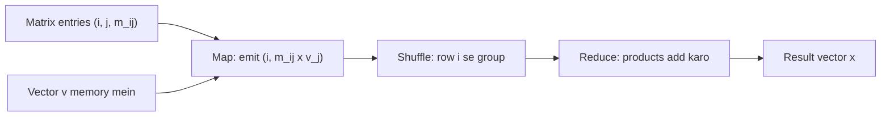

**In simple words:** matrix $M$ ko vector $v$ se multiply karne ke liye har result element $x_i = \sum_j m_{ij} v_j$ hota hai. MapReduce mein **map** step har $m_{ij}$ ko $v_j$ se multiply karta hai aur product ko row number $i$ ka label deta hai. **Reduce** step same row number wale saare products add karta hai. Vector chhota hota hai, isliye har map task uski ek copy memory mein rakhta hai. <Cite id="hadoop-ecosystem-mmds" loc="§2.3.1" /> <Cite id="mapreduce-algorithms-gfg-matmul" />

**Pseudo code**

```text
map(i, j, m_ij):                 # M ki ek non-zero entry; v[j] memory mein hai
    emit(i, m_ij * v[j])

reduce(i, values):               # row i ke saare products
    emit(i, sum(values))
```



<Cite id="mapreduce-algorithms-gfg-matmul" loc="diagram" />

<Sum>

<Given>

$$
M = \begin{bmatrix} 1 & 2 & 3 \\ 4 & 5 & 6 \\ 7 & 8 & 9 \end{bmatrix}, \quad v = \begin{bmatrix} 1 \\ 2 \\ 3 \end{bmatrix}
$$

</Given>

<Find>

MapReduce se $x = Mv$.

</Find>

<Steps>

1. **Map.** Har entry $(i, j, m_{ij})$ ke liye $(i, m_{ij} \times v_j)$ emit karo, $v_1 = 1$, $v_2 = 2$, $v_3 = 3$ lekar. *Reason: har product answer ki row $i$ ka hai.*

   | Entry $(i, j, m_{ij})$ | Product $m_{ij} \times v_j$ | Map output |
   |---|---|---|
   | (1, 1, 1) | $1 \times 1 = 1$ | (1, 1) |
   | (1, 2, 2) | $2 \times 2 = 4$ | (1, 4) |
   | (1, 3, 3) | $3 \times 3 = 9$ | (1, 9) |
   | (2, 1, 4) | $4 \times 1 = 4$ | (2, 4) |
   | (2, 2, 5) | $5 \times 2 = 10$ | (2, 10) |
   | (2, 3, 6) | $6 \times 3 = 18$ | (2, 18) |
   | (3, 1, 7) | $7 \times 1 = 7$ | (3, 7) |
   | (3, 2, 8) | $8 \times 2 = 16$ | (3, 16) |
   | (3, 3, 9) | $9 \times 3 = 27$ | (3, 27) |

2. **Shuffle.** Row se group karo: 1 ko [1, 4, 9], 2 ko [4, 10, 18], 3 ko [7, 16, 27] milta hai. *Reason: framework same keys ko ek jagah lata hai.*
3. **Reduce.** Har list add karo: row 1: $1 + 4 + 9 = 14$; row 2: $4 + 10 + 18 = 32$; row 3: $7 + 16 + 27 = 50$.

</Steps>

<Answer>

$$
x = \begin{bmatrix} 14 \\ 32 \\ 50 \end{bmatrix}
$$

</Answer>

<Box kind="verify">

Check 1: $x$ ki entries add karo: $14 + 32 + 50 = 96$. $M$ ke column sums $12, 15, 18$ hain, aur $12 \times 1 + 15 \times 2 + 18 \times 3 = 12 + 30 + 54 = 96$, same.

Check 2: row 2 ko dot product se nikalo: $(4, 5, 6) \cdot (1, 2, 3) = 4 + 10 + 18 = 32$, reducer ke answer jaisa.

</Box>

</Sum>

**Agar vector memory ke liye bahut bada ho:** matrix ko vertical stripes mein aur vector ko matching horizontal pieces mein kaato, to har map task ko $v$ ka sirf ek piece chahiye. <Cite id="hadoop-ecosystem-mmds" loc="§2.3.2" />

**Matrix times matrix (one step).** $C = AB$ ke liye output cell $(i, k)$ ko key banao. Map har $a_{ij}$ ko har cell $(i, k)$ pe aur har $b_{jk}$ ko har cell $(i, k)$ pe bhejta hai, $j$ ke tag ke saath. Reduce same $j$ ko pair karke multiply aur add karta hai. <Cite id="mapreduce-algorithms-wiki-matmul" />

**Conclusion:** $Mv = (14, 32, 50)^T$, aur kaam naturally parallel hai kyunki har row alag se compute hoti hai. <Cite id="mapreduce-gfg-mr" />

Exam mein English mein likho: "Map emits (i, m_ij x v_j) for each matrix entry and reduce adds all values with the same row key i."
