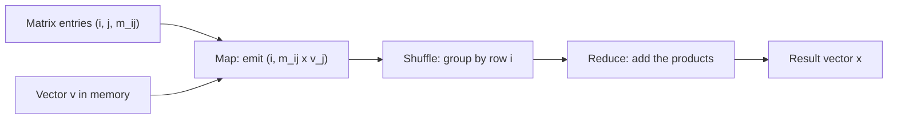

**In simple words:** to multiply a matrix $M$ by a vector $v$, each result element is $x_i = \sum_j m_{ij} v_j$. In MapReduce, the **map** step multiplies every $m_{ij}$ by $v_j$ and labels the product with the row number $i$. The **reduce** step adds all products that have the same row number. The vector is small, so every map task keeps a copy of it in memory. <Cite id="hadoop-ecosystem-mmds" loc="§2.3.1" /> <Cite id="mapreduce-algorithms-gfg-matmul" />

**Pseudo code**

```text
map(i, j, m_ij):                 # one non-zero entry of M; v[j] is in memory
    emit(i, m_ij * v[j])

reduce(i, values):               # all products of row i
    emit(i, sum(values))
```



<Cite id="mapreduce-algorithms-gfg-matmul" loc="diagram" />

<Sum>

<Given>

$$
M = \begin{bmatrix} 1 & 2 & 3 \\ 4 & 5 & 6 \\ 7 & 8 & 9 \end{bmatrix}, \quad v = \begin{bmatrix} 1 \\ 2 \\ 3 \end{bmatrix}
$$

</Given>

<Find>

$x = Mv$ using MapReduce.

</Find>

<Steps>

1. **Map.** For each entry $(i, j, m_{ij})$ emit $(i, m_{ij} \times v_j)$, using $v_1 = 1$, $v_2 = 2$, $v_3 = 3$. *Reason: each product belongs to row $i$ of the answer.*

   | Entry $(i, j, m_{ij})$ | Product $m_{ij} \times v_j$ | Map output |
   |---|---|---|
   | (1, 1, 1) | $1 \times 1 = 1$ | (1, 1) |
   | (1, 2, 2) | $2 \times 2 = 4$ | (1, 4) |
   | (1, 3, 3) | $3 \times 3 = 9$ | (1, 9) |
   | (2, 1, 4) | $4 \times 1 = 4$ | (2, 4) |
   | (2, 2, 5) | $5 \times 2 = 10$ | (2, 10) |
   | (2, 3, 6) | $6 \times 3 = 18$ | (2, 18) |
   | (3, 1, 7) | $7 \times 1 = 7$ | (3, 7) |
   | (3, 2, 8) | $8 \times 2 = 16$ | (3, 16) |
   | (3, 3, 9) | $9 \times 3 = 27$ | (3, 27) |

2. **Shuffle.** Group by row: 1 gets [1, 4, 9], 2 gets [4, 10, 18], 3 gets [7, 16, 27]. *Reason: the framework brings equal keys together.*
3. **Reduce.** Add each list: row 1: $1 + 4 + 9 = 14$; row 2: $4 + 10 + 18 = 32$; row 3: $7 + 16 + 27 = 50$.

</Steps>

<Answer>

$$
x = \begin{bmatrix} 14 \\ 32 \\ 50 \end{bmatrix}
$$

</Answer>

<Box kind="verify">

Check 1: add the entries of $x$: $14 + 32 + 50 = 96$. The column sums of $M$ are $12, 15, 18$, and $12 \times 1 + 15 \times 2 + 18 \times 3 = 12 + 30 + 54 = 96$, the same.

Check 2: compute row 2 as a dot product: $(4, 5, 6) \cdot (1, 2, 3) = 4 + 10 + 18 = 32$, the same as the reducer's answer.

</Box>

</Sum>

**If the vector is too big for memory:** cut the matrix into vertical stripes and the vector into matching horizontal pieces, so each map task needs only one piece of $v$. <Cite id="hadoop-ecosystem-mmds" loc="§2.3.2" />

**Matrix times matrix (one step).** For $C = AB$ make the output cell $(i, k)$ the key. Map sends each $a_{ij}$ to every cell $(i, k)$ and each $b_{jk}$ to every cell $(i, k)$, tagged with $j$. Reduce pairs equal $j$, multiplies and adds. <Cite id="mapreduce-algorithms-wiki-matmul" />

**Conclusion:** $Mv = (14, 32, 50)^T$, and the work is naturally parallel because each row is computed independently. <Cite id="mapreduce-gfg-mr" />
