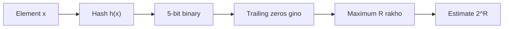

**In simple words:** Flajolet-Martin (FM) stream mein kitne **alag-alag** items hain ye estimate karta hai, unhe store kiye bina. Har item ko binary number mein hash karo aur uske **trailing zeros** (right end ke zeros) gino. Lamba trailing zeros ka run rare hota hai, isliye dekha gaya sabse lamba run $R$ size batata hai: estimate $= 2^R$. <Cite id="stream-counting-mmds-home" loc="§4.4" /> <Cite id="stream-counting-fm1985" /> <Cite id="stream-counting-gfg-fm" />

**Ye kaam kyun karta hai:** lagbhag aadhe hash values 0 pe khatam hote hain, chauthai 00 pe, aur aise hi aage. $r$ zeros pe khatam hone ka chance $2^{-r}$ hai, to $R$ zeros dikhna lagbhag $2^R$ alag items ka sanket hai.

**Steps:** (1) har element hash karo, (2) result ko 5-bit number likho, (3) trailing zeros gino, (4) maximum $R$ lo, (5) estimate $2^R$.

<Sum>

<Given>

stream $S = \{4, 2, 5, 9, 1, 6, 3, 7\}$ aur hash $h(x) = (x + 6) \bmod 32$ (paper ka "$ax + b$" jahan $a = 1$, $b = 6$), 5-bit binary number mein likha hua.

</Given>

<Find>

distinct elements ki estimated sankhya.

</Find>

<Steps>

1. **Har element hash karo aur 5 bits likho.** Phir trailing zeros gino:

   | $x$ | $x + 6$ | mod 32 | 5-bit binary | Trailing zeros |
   |---|---|---|---|---|
   | 4 | 10 | 10 | 01010 | 1 |
   | 2 | 8 | 8 | 01000 | 3 |
   | 5 | 11 | 11 | 01011 | 0 |
   | 9 | 15 | 15 | 01111 | 0 |
   | 1 | 7 | 7 | 00111 | 0 |
   | 6 | 12 | 12 | 01100 | 2 |
   | 3 | 9 | 9 | 01001 | 0 |
   | 7 | 13 | 13 | 01101 | 0 |

2. **Maximum** trailing zeros lo: $R = \max(1, 3, 0, 0, 0, 2, 0, 0) = 3$. *Reason: FM sirf sabse lamba run rakhta hai.*
3. **Estimate** $= 2^R = 2^3 = 8$.

</Steps>

<Answer>

$R = 3$, to distinct elements ka estimate $2^3 = 8$ hai.

</Answer>

<Box kind="verify">

Binary check: $10 = 8 + 2$, $8 = 8$, $11 = 8 + 2 + 1$, $15 = 8 + 4 + 2 + 1$, $7 = 4 + 2 + 1$, $12 = 8 + 4$, $9 = 8 + 1$, $13 = 8 + 4 + 1$, sab table se match karte hain.

Even se ginti: even hash values 10, 8 aur 12 hain (kam se kam ek trailing zero), 4 ke multiples 8 aur 12 hain, aur 8 ka multiple sirf 8 hai. To sabse lamba run 3 hai.

Stream mein sach mein 8 alag elements hain, to estimate 8 yahan exact hai. Ye luck hai: ek hash function aam taur pe rough hota hai, aur practice mein kai hash functions milaye jate hain (groups ke andar average, phir groups ka median). <Cite id="stream-counting-wiki-fm" />

</Box>

</Sum>

<Cite id="stream-counting-gfg-fm" loc="diagram" />

**Conclusion:** trailing zeros ka sabse lamba run 3 hai, to FM $2^3 = 8$ distinct elements estimate karta hai, sirf ek number ki memory se.

Exam mein English mein likho: "Flajolet-Martin hashes each element, counts trailing zeros, takes the maximum R and estimates 2^R distinct elements."
