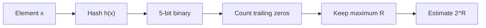

**In simple words:** Flajolet-Martin (FM) estimates how many **different** items a stream has without storing them. Hash every item to a binary number and count its **trailing zeros** (zeros at the right end). A long run of trailing zeros is rare, so the longest run $R$ seen tells the size: estimate $= 2^R$. <Cite id="stream-counting-mmds-home" loc="§4.4" /> <Cite id="stream-counting-fm1985" /> <Cite id="stream-counting-gfg-fm" />

**Why it works:** about half of all hash values end in 0, a quarter in 00, and so on. A value ending in $r$ zeros has chance $2^{-r}$, so seeing $R$ zeros suggests about $2^R$ different items.

**Steps:** (1) hash every element, (2) write the result as a 5-bit number, (3) count its trailing zeros, (4) take the maximum $R$, (5) estimate $2^R$.

<Sum>

<Given>

stream $S = \{4, 2, 5, 9, 1, 6, 3, 7\}$ and hash $h(x) = (x + 6) \bmod 32$ (the paper's "$ax + b$" with $a = 1$, $b = 6$), written as a 5-bit binary number.

</Given>

<Find>

the estimated number of distinct elements.

</Find>

<Steps>

1. **Hash each element and write 5 bits.** Then count the trailing zeros:

   | $x$ | $x + 6$ | mod 32 | 5-bit binary | Trailing zeros |
   |---|---|---|---|---|
   | 4 | 10 | 10 | 01010 | 1 |
   | 2 | 8 | 8 | 01000 | 3 |
   | 5 | 11 | 11 | 01011 | 0 |
   | 9 | 15 | 15 | 01111 | 0 |
   | 1 | 7 | 7 | 00111 | 0 |
   | 6 | 12 | 12 | 01100 | 2 |
   | 3 | 9 | 9 | 01001 | 0 |
   | 7 | 13 | 13 | 01101 | 0 |

2. **Take the maximum** trailing zeros: $R = \max(1, 3, 0, 0, 0, 2, 0, 0) = 3$. *Reason: FM keeps only the longest run.*
3. **Estimate** $= 2^R = 2^3 = 8$.

</Steps>

<Answer>

$R = 3$, so the estimated number of distinct elements is $2^3 = 8$.

</Answer>

<Box kind="verify">

Binary check: $10 = 8 + 2$, $8 = 8$, $11 = 8 + 2 + 1$, $15 = 8 + 4 + 2 + 1$, $7 = 4 + 2 + 1$, $12 = 8 + 4$, $9 = 8 + 1$, $13 = 8 + 4 + 1$, all matching the table.

Count by evenness: the even hash values are 10, 8 and 12 (at least one trailing zero), the multiples of 4 are 8 and 12, and only 8 is a multiple of 8. So the longest run is 3.

The stream really has 8 different elements, so the estimate 8 is exact here. This is luck: one hash function is rough in general, and in practice many hash functions are combined (average inside groups, then median of the groups). <Cite id="stream-counting-wiki-fm" />

</Box>

</Sum>

<Cite id="stream-counting-gfg-fm" loc="diagram" />

**Conclusion:** the longest run of trailing zeros is 3, so FM estimates $2^3 = 8$ distinct elements, using memory for just one number.
