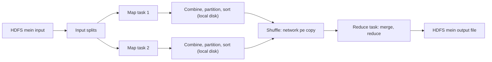

**In simple words:** MapReduce job ek fixed pipeline mein chalta hai. Input **splits** mein kata jata hai, **map** tasks har split ko `(key, value)` pairs mein badalte hain, pairs key se group hote hain (**shuffle and sort**), aur **reduce** tasks har group ko final answer mein combine karte hain. Programmer sirf map aur reduce likhta hai; baaki framework karta hai. <Cite id="mapreduce-gfg-mr" /> <Cite id="hadoop-ecosystem-dean2004" loc="§3" />

**Ye kyun zaroori hai:** data split karna, scheduling, data move karna aur failures se recover karna haath se program karna mushkil hai. MapReduce ye sab chhupa deta hai.

<Cite id="mapreduce-gfg-mr" loc="diagram" />

**Execution ke steps.** <Cite id="mapreduce-tp" /> <Cite id="hadoop-ecosystem-apache-mr-tutorial" />

1. **Submit.** Client job submit karta hai; cluster manager ek job master start karta hai.
2. **Split.** Input splits mein kata jata hai (lagbhag ek HDFS block har ek), har split ke liye ek map task, data ke paas chalta hai.
3. **Map.** Har map task apne records padhta hai aur `(key, value)` pairs emit karta hai.
4. **Combine, partition, sort.** Optional **combiner** network bachane ke liye pairs ko local add karta hai. **Partitioner** har key ke liye reducer chunta hai, $\text{hash}(key) \bmod R$.
5. **Shuffle.** Har reducer har mapper se network pe apna hissa copy karta hai.
6. **Reduce.** Reducer data ko sorted groups mein merge karke har group pe reduce chalata hai. Reduce function maps khatam hone ke baad hi start hota hai.
7. **Output.** Results HDFS mein likhe jate hain, har reducer ki ek file.

<Sum>

<Given>

Combiner aur ek reducer ke saath word count. Split 1: "big data big". Split 2: "data big tools".

</Given>

<Find>

har stage ka output aur final counts.

</Find>

<Steps>

1. **Map.** Split 1: (big,1) (data,1) (big,1). Split 2: (data,1) (big,1) (tools,1).
2. **Combiner (local add).** Split 1: (big,2) (data,1). Split 2 mein repeat nahi, to wahi rehta hai. Bheje gaye pairs: $2 + 3 = 5$, 6 ke bajay.
3. **Shuffle and sort.** big: [2, 1], data: [1, 1], tools: [1].
4. **Reduce.** Har list add karo: big $= 2 + 1 = 3$, data $= 1 + 1 = 2$, tools $= 1$.

</Steps>

<Answer>

big 3, data 2, tools 1.

</Answer>

<Box kind="verify">

Input mein 6 words hain aur $3 + 2 + 1 = 6$. Seedhi ginti: big split 1 mein 2 baar aur split 2 mein ek baar, yani 3; data har split mein ek baar, yani 2. <Cite id="mapreduce-gfg-wordcount" />

</Box>

</Sum>

**Conclusion:** framework splitting, scheduling, shuffle aur failures sambhalta hai, isliye programmer sirf map aur reduce likhta hai.

Exam mein English mein likho: "The MapReduce pipeline is input split, map, combine, partition and sort, shuffle, reduce and output to HDFS."
