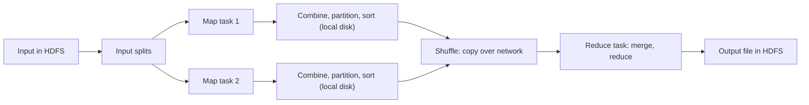

**In simple words:** a MapReduce job runs as a fixed pipeline. The input is cut into **splits**, **map** tasks turn each split into `(key, value)` pairs, the pairs are grouped by key (**shuffle and sort**), and **reduce** tasks combine each group into the final answer. The programmer writes only map and reduce; the framework does the rest. <Cite id="mapreduce-gfg-mr" /> <Cite id="hadoop-ecosystem-dean2004" loc="§3" />

**Why it is needed:** splitting data, scheduling, moving data and recovering from failures are hard to program by hand. MapReduce hides them.

<Cite id="mapreduce-gfg-mr" loc="diagram" />

**Steps of execution.** <Cite id="mapreduce-tp" /> <Cite id="hadoop-ecosystem-apache-mr-tutorial" />

1. **Submit.** The client submits the job; the cluster manager starts a job master.
2. **Split.** The input is cut into splits (about one HDFS block each), one map task per split, run near the data.
3. **Map.** Each map task reads its records and emits `(key, value)` pairs.
4. **Combine, partition, sort.** An optional **combiner** adds up pairs locally to save network. The **partitioner** picks the reducer for each key, $\text{hash}(key) \bmod R$.
5. **Shuffle.** Each reducer copies its part from every mapper over the network.
6. **Reduce.** The reducer merges the data into sorted groups and runs reduce on each. The reduce function starts only after all maps finish.
7. **Output.** Results are written to HDFS, one file per reducer.

<Sum>

<Given>

Word count with a combiner and one reducer. Split 1: "big data big". Split 2: "data big tools".

</Given>

<Find>

the output of each stage and the final counts.

</Find>

<Steps>

1. **Map.** Split 1: (big,1) (data,1) (big,1). Split 2: (data,1) (big,1) (tools,1).
2. **Combiner (local add).** Split 1: (big,2) (data,1). Split 2 has no repeat, so it stays. Pairs sent: $2 + 3 = 5$ instead of 6.
3. **Shuffle and sort.** big: [2, 1], data: [1, 1], tools: [1].
4. **Reduce.** Add each list: big $= 2 + 1 = 3$, data $= 1 + 1 = 2$, tools $= 1$.

</Steps>

<Answer>

big 3, data 2, tools 1.

</Answer>

<Box kind="verify">

The input has 6 words and $3 + 2 + 1 = 6$. Direct count: big appears 2 times in split 1 and once in split 2, which is 3; data appears once in each split, which is 2. <Cite id="mapreduce-gfg-wordcount" />

</Box>

</Sum>

**Conclusion:** the framework handles splitting, scheduling, shuffle and failures, so the programmer writes only map and reduce.
