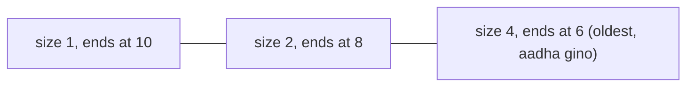

**In simple words:** hamare paas 0 aur 1 ki stream hai aur humein pichle $N$ bits mein 1's ki ginti chahiye. Exact counting ke liye saare $N$ bits memory mein chahiye. **DGIM algorithm** (Datar, Gionis, Indyk, Motwani, 2002) sirf lagbhag $\log N$ **buckets** rakhta hai, har bucket 1's ke ek group ka summary hai, aur $O(\log^2 N)$ bits mein sach ke 50 percent ke andar jawab deta hai. <Cite id="stream-counting-mmds-home" loc="§4.6" /> <Cite id="stream-counting-wiki-dsm" />

**Buckets.** Bucket apni **size** (1's ki sankhya, hamesha 2 ki power) aur apne right end ka **timestamp** (sabse recent 1) rakhta hai. Rules: har bucket 1 pe khatam hota hai; har 1 theek ek bucket mein hota hai; har size ke ek ya do buckets hote hain; peeche jaate hue sizes kabhi kam nahi hoti; jis bucket ka timestamp window se bahar nikal jaye wo hata diya jata hai.

**Time $t$ pe bit aane par update**

1. Sabse purana bucket hatao agar uska timestamp $\le t - N$ hai.
2. 0 aaye to aur kuch nahi badalta.
3. 1 aaye to size 1 aur timestamp $t$ ka naya bucket banta hai.
4. Agar ab teen buckets ki size same hai, to unme se **do sabse purane** ko merge karke double size ka ek bucket banao (dono mein se naye ka timestamp). Agli size ke liye dohrao.

**Pichle $N$ bits ke liye query:** window ko overlap karne wale sabse purane bucket $B$ se naye saare buckets ki sizes add karo, phir **$B$ ki size ka aadha** add karo. Sach count "naye buckets + 1" aur "naye buckets + $B$ ki size" ke beech hota hai, isliye error $B$ ke aadhe se zyada nahi, jo sach count ke 50 percent se kam hai. <Cite id="stream-counting-mmds-home" loc="§4.6" />

<Sum>

<Given>

Stream (time 1 pehle): `1 0 1 1 0 1 1 1 0 1` (10 bits). Window $N = 8$. Bucket ko (size, timestamp) likhte hain.

</Given>

<Find>

har 1 ke baad buckets, aur pichle 8 bits mein 1's ka estimate.

</Find>

<Steps>

1. Update rules bit by bit lagao (0 kuch nahi badalta, isliye sirf 1's dikhaye hain):

   | $t$ | Bit | Buckets baad mein (newest pehle) | Kyun |
   |---|---|---|---|
   | 1 | 1 | (1,1) | naya bucket |
   | 3 | 1 | (1,3) (1,1) | size 1 ke do allowed hain |
   | 4 | 1 | (1,4) (2,3) | size 1 ke teen, to (1,3) aur (1,1) merge hoke (2,3) |
   | 6 | 1 | (1,6) (1,4) (2,3) | size 1 ke do |
   | 7 | 1 | (1,7) (2,6) (2,3) | size 1 ke teen, to (1,6) aur (1,4) merge hoke (2,6) |
   | 8 | 1 | (1,8) (1,7) (2,6) (2,3) | allowed |
   | 10 | 1 | (1,10) (2,8) (4,6) | size 1 ke teen, to (1,8) aur (1,7) merge hoke (2,8); ab size 2 ke teen, to (2,6) aur (2,3) merge hoke (4,6) |

2. $t = 10$ pe window mein $10 - 8 = 2$ se bade timestamps hain, yani 3 se 10. Kisi bucket ka timestamp $\le 2$ nahi, to koi drop nahi hota.
3. Window ko overlap karne wala sabse purana bucket $B = (4,6)$ hai. Usse naye buckets ki sizes $1 + 2 = 3$ hain.
4. $B$ ka aadha add karo: $4 / 2 = 2$. Estimate $= 3 + 2 = 5$.

</Steps>

<Answer>

Final buckets (1,10) (2,8) (4,6). Pichle 8 bits mein 1's ka estimate $= 5$.

</Answer>

<Box kind="verify">

Seedha gino: times 3 se 10 ke bits 1 1 0 1 1 1 0 1 hain, jisme chhe 1's hain (3, 4, 6, 7, 8, 10 pe). To sach answer 6 hai aur estimate 5 mein 1 ka fark hai, jo $B$ ke aadhe (2) ke andar hai. Buckets stream ke saare saat 1's hold karte hain (1, 3, 4, 6, 7, 8, 10 pe): $1 + 2 + 4 = 7$. Bucket (4,6) 1, 3, 4 aur 6 ke 1's cover karta hai; inme se teen (3, 4, 6) window ke andar hain, jabki DGIM aadha ginta hai, yani 2.

</Box>

</Sum>

<Cite id="stream-counting-cs246-slides" loc="diagram" />

**Advantages:** bahut kam memory, fast update, guaranteed error bound. **Disadvantages:** answer sirf approximate hai, aur plain DGIM 0/1 streams ke liye hai. <Cite id="stream-counting-wiki-streaming" />

**Conclusion:** DGIM $N$ bits ki window ko lagbhag $\log N$ buckets se replace karta hai aur phir bhi window counts ek known error ke andar deta hai.

Exam mein English mein likho: "DGIM keeps buckets of power-of-2 sizes; the estimate is the sum of all buckets newer than the oldest one plus half of the oldest bucket."
