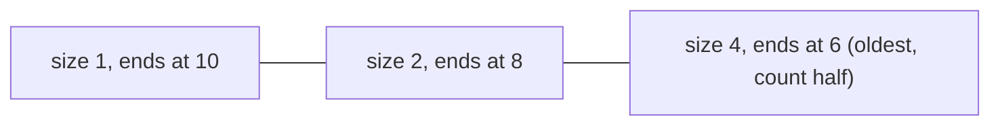

**In simple words:** we have a stream of 0s and 1s and want to know how many 1s are in the last $N$ bits. Counting exactly needs all $N$ bits in memory. The **DGIM algorithm** (Datar, Gionis, Indyk, Motwani, 2002) keeps only about $\log N$ **buckets**, each summarising a group of 1s, and answers within 50 percent of the truth using $O(\log^2 N)$ bits. <Cite id="stream-counting-mmds-home" loc="§4.6" /> <Cite id="stream-counting-wiki-dsm" />

**Buckets.** A bucket stores its **size** (the number of 1s, always a power of 2) and the **timestamp** of its right end (its most recent 1). The rules: every bucket ends in a 1; every 1 is in exactly one bucket; there are one or two buckets of each size; sizes never decrease going back in time; a bucket whose timestamp leaves the window is dropped.

**Update when a bit arrives at time $t$**

1. Drop the oldest bucket if its timestamp is $\le t - N$.
2. A 0 changes nothing more.
3. A 1 creates a bucket of size 1 with timestamp $t$.
4. If three buckets now have the same size, merge the **two oldest** of them into one of double size (with the newer of the two timestamps). Repeat for the next size up.

**Query for the last $N$ bits:** add the sizes of all buckets newer than the oldest bucket $B$ that overlaps the window, then add **half of the size of $B$**. The true count lies between "newer buckets + 1" and "newer buckets + size of $B$", so the error is at most half of $B$, which is under 50 percent of the true count. <Cite id="stream-counting-mmds-home" loc="§4.6" />

<Sum>

<Given>

Stream (time 1 first): `1 0 1 1 0 1 1 1 0 1` (10 bits). Window $N = 8$. A bucket is written (size, timestamp).

</Given>

<Find>

the buckets after every 1 and the estimate of the number of 1s in the last 8 bits.

</Find>

<Steps>

1. Apply the update rules bit by bit (a 0 changes nothing, so only the 1s are shown):

   | $t$ | Bit | Buckets after (newest first) | Why |
   |---|---|---|---|
   | 1 | 1 | (1,1) | new bucket |
   | 3 | 1 | (1,3) (1,1) | two of size 1 is allowed |
   | 4 | 1 | (1,4) (2,3) | three of size 1, so (1,3) and (1,1) merge into (2,3) |
   | 6 | 1 | (1,6) (1,4) (2,3) | two of size 1 |
   | 7 | 1 | (1,7) (2,6) (2,3) | three of size 1, so (1,6) and (1,4) merge into (2,6) |
   | 8 | 1 | (1,8) (1,7) (2,6) (2,3) | allowed |
   | 10 | 1 | (1,10) (2,8) (4,6) | three of size 1, so (1,8) and (1,7) merge into (2,8); now three of size 2, so (2,6) and (2,3) merge into (4,6) |

2. At $t = 10$ the window holds timestamps above $10 - 8 = 2$, that is 3 to 10. No bucket has timestamp $\le 2$, so none is dropped.
3. The oldest bucket overlapping the window is $B = (4,6)$. The buckets newer than it have sizes $1 + 2 = 3$.
4. Add half of $B$: $4 / 2 = 2$. Estimate $= 3 + 2 = 5$.

</Steps>

<Answer>

Final buckets (1,10) (2,8) (4,6). Estimated number of 1s in the last 8 bits $= 5$.

</Answer>

<Box kind="verify">

Count directly: times 3 to 10 are 1 1 0 1 1 1 0 1, which has six 1s (at 3, 4, 6, 7, 8, 10). So the true answer is 6 and the estimate 5 is off by 1, which is within half of $B$ (2). The buckets hold all seven 1s of the stream (at 1, 3, 4, 6, 7, 8, 10): $1 + 2 + 4 = 7$. Bucket (4,6) covers the 1s at 1, 3, 4 and 6; only three of them (3, 4, 6) are inside the window, while DGIM counts half, which is 2.

</Box>

</Sum>

<Cite id="stream-counting-cs246-slides" loc="diagram" />

**Advantages:** very small memory, fast update, guaranteed error bound. **Disadvantages:** the answer is only approximate, and plain DGIM works for 0/1 streams. <Cite id="stream-counting-wiki-streaming" />

**Conclusion:** DGIM replaces a window of $N$ bits by about $\log N$ buckets and still answers window counts within a known error.
