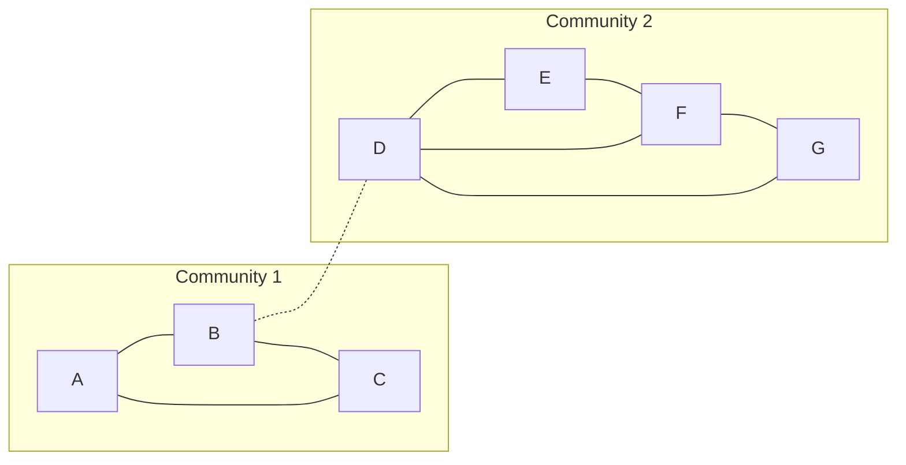

**In simple words:** Girvan-Newman algorithm communities ko aise dhoondhta hai ki groups ke beech **bridge** banne wale edges hata deta hai. Bridge bahut saare shortest paths pe hota hai, isliye uska **edge betweenness** high hota hai. Sabse high betweenness wala edge baar baar hataate hain jab tak graph alag tukdon mein na toot jaye, aur har tukda ek community hai. <Cite id="social-network-graphs-girvan-newman2002" /> <Cite id="social-network-graphs-mmds-book" loc="§10.2" />

**Steps**

1. Nodes ke har pair ke liye shortest paths dhoondo. Agar kai hon to ek unit credit unme barabar baant do.
2. Edge ka betweenness sab pairs se mila total credit hai.
3. Sabse high betweenness wala edge hata do.
4. Dobara compute karo aur graph tootne tak dohrao. <Cite id="social-network-graphs-gfg-girvan-newman" />

<Sum>

<Given>

Undirected graph, 7 nodes aur 9 edges: A-B, A-C, B-C, B-D, D-E, D-F, D-G, E-F, F-G (paper ki figure se).

</Given>

<Find>

Girvan-Newman se communities.

</Find>

<Steps>

1. **Shape dekho.** A, B, C ek triangle banate hain. D, E, F, G ek group hai (D-E, D-F, D-G, E-F, F-G). Dono groups ke beech sirf B-D ka link hai.
2. **Edge betweenness.** Nodes ke har pair ka credit 1 hai, agar do shortest paths hon to baanto. Har edge ke liye wo pairs gino jinka shortest path us edge se jata hai:

   | Edge | Use karne wale pairs | Betweenness |
   |---|---|---|
   | B-D | (A, B, C) aur (D, E, F, G) ke saare 12 pairs | 12 |
   | A-B | A-B, aur A ke D, E, F, G se pairs | 5 |
   | B-C | B-C, aur C ke D, E, F, G se pairs | 5 |
   | A-C | sirf A-C | 1 |
   | D-E | D-E, A-E, B-E, C-E, aur E-G ka aadha | 1 + 3 + 0.5 = 4.5 |
   | D-G | D-G, A-G, B-G, C-G, aur E-G ka aadha | 1 + 3 + 0.5 = 4.5 |
   | D-F | D-F, A-F, B-F, C-F | 4 |
   | E-F | E-F, aur E-G ka aadha | 1 + 0.5 = 1.5 |
   | F-G | F-G, aur E-G ka aadha | 1 + 0.5 = 1.5 |

   *Reason: E-G ke do shortest paths hain, E-F-G aur E-D-G, to E-F, F-G, D-E, D-G har ek ko 0.5 milta hai.*
3. **Sabse high hatao.** B-D ka 12 hai, baaki se bahut upar. Ise hata do. *Reason: dono groups ke beech ye akela bridge hai.*
4. **Result.** Graph do connected tukdon mein toot jata hai: \{A, B, C\} aur \{D, E, F, G\}.

</Steps>

<Answer>

do communities: \{A, B, C\} aur \{D, E, F, G\}. Bridge B-D sabse pehle hata.

</Answer>

<Box kind="verify">

Check 1: betweenness values ka total sab shortest-path lengths ke total ke barabar hona chahiye. Values ka total $12 + 5 + 5 + 1 + 4.5 + 4.5 + 4 + 1.5 + 1.5 = 39$. Path lengths: A, B, C ke andar: length 1 ke 3 pairs, total 3. Groups ke beech: A se D, E, F, G tak $2 + 3 + 3 + 3 = 11$; B ka $1 + 2 + 2 + 2 = 7$; C ka $2 + 3 + 3 + 3 = 11$; total 29. D, E, F, G ke andar: length 1 ke paanch pairs aur E-G length 2, total 7. Sum: $3 + 29 + 7 = 39$. Match karta hai.

Check 2 (modularity): $m = 9$ edges. \{A, B, C\} mein 3 edges aur degree total $2 + 3 + 2 = 7$ hai. \{D, E, F, G\} mein 5 edges aur degree total $4 + 2 + 3 + 2 = 11$ hai. Dono totals $18 = 2 \times 9$ banate hain, jaisa hona chahiye. $Q = (3/9 - (7/18)^2) + (5/9 - (11/18)^2) = 59/324 + 59/324 = 118/324 \approx 0.36$. Ye positive hai, to split achha hai. <Cite id="social-network-graphs-wiki-girvan-newman" />

</Box>

</Sum>

<Cite id="social-network-graphs-gfg-girvan-newman" loc="diagram" />

Algorithm aage bhi chal sakta hai: aur edges hatane se groups aur tootte hain, aur dendrogram (splits ka tree) wahan kaata ja sakta hai jahan modularity sabse zyada ho.

**Conclusion:** bridge B-D sabse zyada shortest paths carry karta hai, isliye Girvan-Newman ise pehle hatata hai aur communities \{A, B, C\} aur \{D, E, F, G\} saamne aati hain.

Exam mein English mein likho: "Girvan-Newman repeatedly removes the edge with the highest betweenness until the graph splits into communities."
