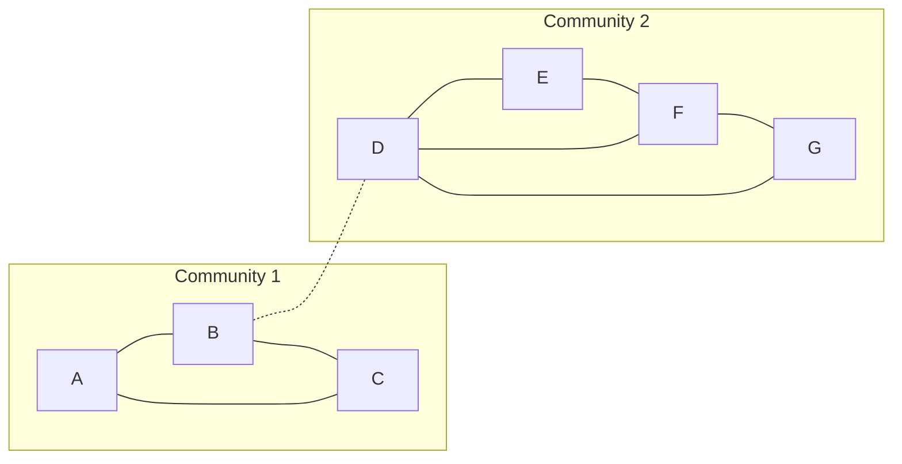

**In simple words:** the Girvan-Newman algorithm finds communities by removing the edges that act as **bridges** between groups. A bridge lies on many shortest paths, so it has a high **edge betweenness**. We remove the edge with the highest betweenness again and again until the graph falls into separate pieces, and each piece is a community. <Cite id="social-network-graphs-girvan-newman2002" /> <Cite id="social-network-graphs-mmds-book" loc="§10.2" />

**Steps**

1. For every pair of nodes, find the shortest paths. If there are several, split one unit of credit equally among them.
2. The betweenness of an edge is the total credit it receives over all pairs.
3. Remove the edge with the highest betweenness.
4. Recompute and repeat until the graph splits. <Cite id="social-network-graphs-gfg-girvan-newman" />

<Sum>

<Given>

Undirected graph with 7 nodes and 9 edges: A-B, A-C, B-C, B-D, D-E, D-F, D-G, E-F, F-G (as listed from the paper's figure).

</Given>

<Find>

the communities, using Girvan-Newman.

</Find>

<Steps>

1. **Look at the shape.** A, B, C form a triangle. D, E, F, G form a group (D-E, D-F, D-G, E-F, F-G). The only link between the two groups is B-D.
2. **Edge betweenness.** Every pair of nodes has credit 1, split if there are two shortest paths. Count the pairs whose shortest path uses each edge:

   | Edge | Pairs that use it | Betweenness |
   |---|---|---|
   | B-D | all 12 pairs (A, B, C) with (D, E, F, G) | 12 |
   | A-B | A-B, and A with D, E, F, G | 5 |
   | B-C | B-C, and C with D, E, F, G | 5 |
   | A-C | A-C only | 1 |
   | D-E | D-E, A-E, B-E, C-E, and half of E-G | 1 + 3 + 0.5 = 4.5 |
   | D-G | D-G, A-G, B-G, C-G, and half of E-G | 1 + 3 + 0.5 = 4.5 |
   | D-F | D-F, A-F, B-F, C-F | 4 |
   | E-F | E-F, and half of E-G | 1 + 0.5 = 1.5 |
   | F-G | F-G, and half of E-G | 1 + 0.5 = 1.5 |

   *Reason: E-G has two shortest paths, E-F-G and E-D-G, so each of E-F, F-G, D-E, D-G gets 0.5.*
3. **Remove the highest.** B-D has 12, far above the rest. Remove it. *Reason: it is the only bridge between the two groups.*
4. **Result.** The graph splits into two connected pieces: \{A, B, C\} and \{D, E, F, G\}.

</Steps>

<Answer>

two communities: \{A, B, C\} and \{D, E, F, G\}. The bridge B-D is removed first.

</Answer>

<Box kind="verify">

Check 1: the betweenness values must add up to the sum of all shortest-path lengths. The sum of values is $12 + 5 + 5 + 1 + 4.5 + 4.5 + 4 + 1.5 + 1.5 = 39$. The path lengths: inside A, B, C: 3 pairs of length 1, total 3. Between the groups: A to D, E, F, G is $2 + 3 + 3 + 3 = 11$; B is $1 + 2 + 2 + 2 = 7$; C is $2 + 3 + 3 + 3 = 11$; total 29. Inside D, E, F, G: five pairs of length 1 and E-G of length 2, total 7. Sum: $3 + 29 + 7 = 39$. It matches.

Check 2 (modularity): $m = 9$ edges. \{A, B, C\} has 3 edges and a degree total of $2 + 3 + 2 = 7$. \{D, E, F, G\} has 5 edges and a degree total of $4 + 2 + 3 + 2 = 11$. The two totals add to $18 = 2 \times 9$, as they must. $Q = (3/9 - (7/18)^2) + (5/9 - (11/18)^2) = 59/324 + 59/324 = 118/324 \approx 0.36$. It is positive, so the split is a good one. <Cite id="social-network-graphs-wiki-girvan-newman" />

</Box>

</Sum>

<Cite id="social-network-graphs-gfg-girvan-newman" loc="diagram" />

The algorithm can keep going: removing more edges splits the groups further, and the dendrogram (tree of splits) can be cut where modularity is highest.

**Conclusion:** the bridge B-D carries the most shortest paths, so Girvan-Newman removes it first and reveals the communities \{A, B, C\} and \{D, E, F, G\}.
