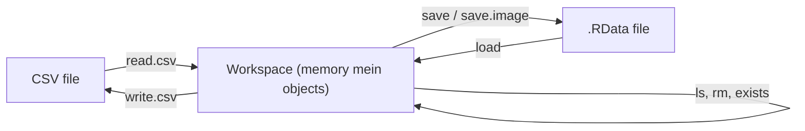

**In simple words:** **workspace** memory ka wo area hai jahan R ek session mein banaye gaye saare objects (variables, vectors, data frames, functions) rakhta hai. R mein in objects ko dekhne, hatane, save karne, load karne aur import ya export karne ke liye functions ka ek group hai. Ye topic CSE (AI&ML) syllabus mein nahi hai, lekin paper mein pucha gaya hai. <Cite id="pyq-2023-12-ce-r-ls" /> <Cite id="pyq-2025-05-ce-gfg-r-df" />



<Cite id="pyq-2025-05-ce-gfg-r-df" loc="diagram" />

| Function | Kya karta hai |
|---|---|
| `getwd()`, `setwd(path)` | Working directory dikhata ya badalta hai (jahan se files padhi aur save hoti hain) |
| `ls()` | Workspace ke objects ki list |
| `rm(x)`, `rm(list = ls())` | Ek object ya saare objects hatata hai |
| `exists("x")` | Batata hai ki x naam ka object hai ya nahi |
| `save(x, y, file = "a.RData")` | Chune hue objects file mein save karta hai |
| `save.image()` | Poora workspace save karta hai (default file `.RData`) |
| `load("a.RData")` | Saved objects ko workspace mein wapas lata hai |
| `read.csv(file)`, `write.csv(df, file)` | Table ko CSV se import ya CSV mein export karta hai |
| `head(df)`, `str(df)`, `summary(df)` | Object ka data dekhne ke liye |

**Example session** <Cite id="pyq-2023-12-ce-r-rm" /> <Cite id="pyq-2023-12-ce-r-save" />

```r
x <- 10
y <- c(1, 2, 3)
name <- "Asha"

ls()                          # [1] "name" "x"    "y"
rm(x)
ls()                          # [1] "name" "y"
exists("x")                   # [1] FALSE

save(y, name, file = "my_data.RData")
rm(list = ls())               # workspace ab khali hai
ls()                          # character(0)
load("my_data.RData")
ls()                          # [1] "name" "y"
```

**Files ke saath kaam** <Cite id="pyq-2023-12-ce-r-getwd" /> <Cite id="pyq-2023-12-ce-r-readtable" />

```r
getwd()                                  # e.g. "C:/Users/student/Documents"
setwd("C:/Users/student/Data")           # folder badlo
df <- data.frame(id = 1:3, mark = c(70, 85, 90))
write.csv(df, "marks.csv", row.names = FALSE)
marks <- read.csv("marks.csv")
head(marks, 2)
```

```
  id mark
1  1   70
2  2   85
```

**Notes:** `ls()` names ko alphabetical order mein deta hai. `rm(list = ls())` sab kuch delete kar deta hai, isliye dhyan se use karo. `save.image()` sab kuch save karta hai, aur quit karte time R ye offer kar sakta hai. Data file ka naam quotes mein text string hota hai.

**Check:** `rm(x)` ke baad sirf `name` aur `y` bache, to `ls()` do names dikhata hai, aur `load()` ke baad wahi do names wapas aate hain, jisse pata chalta hai ki `save()` aur `load()` ek jodi hain.

**Conclusion:** `getwd`, `setwd`, `ls`, `rm`, `save`, `load`, `read.csv` aur `write.csv` user ko R workspace ka data manage karne aur andar-bahar le jane dete hain.

Exam mein English mein likho: "ls() lists the objects in the workspace, rm() removes them, save() and load() store and restore them in an .RData file, and read.csv() and write.csv() import and export tables."
