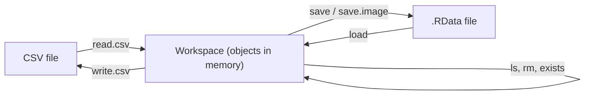

**In simple words:** the **workspace** is the area in memory where R keeps all the objects (variables, vectors, data frames, functions) you create in a session. R has a group of functions to see, remove, save, load and import or export these objects. This topic is not in the CSE (AI&ML) syllabus, but the paper asks it. <Cite id="pyq-2023-12-ce-r-ls" /> <Cite id="pyq-2025-05-ce-gfg-r-df" />



<Cite id="pyq-2025-05-ce-gfg-r-df" loc="diagram" />

| Function | What it does |
|---|---|
| `getwd()`, `setwd(path)` | Show or change the working directory (where files are read and saved) |
| `ls()` | List the objects in the workspace |
| `rm(x)`, `rm(list = ls())` | Remove one object, or all objects |
| `exists("x")` | Tell whether an object named x exists |
| `save(x, y, file = "a.RData")` | Save chosen objects to a file |
| `save.image()` | Save the whole workspace (default file `.RData`) |
| `load("a.RData")` | Bring saved objects back into the workspace |
| `read.csv(file)`, `write.csv(df, file)` | Import or export a table as CSV |
| `head(df)`, `str(df)`, `summary(df)` | Look at the data in an object |

**Example session** <Cite id="pyq-2023-12-ce-r-rm" /> <Cite id="pyq-2023-12-ce-r-save" />

```r
x <- 10
y <- c(1, 2, 3)
name <- "Asha"

ls()                          # [1] "name" "x"    "y"
rm(x)
ls()                          # [1] "name" "y"
exists("x")                   # [1] FALSE

save(y, name, file = "my_data.RData")
rm(list = ls())               # workspace is now empty
ls()                          # character(0)
load("my_data.RData")
ls()                          # [1] "name" "y"
```

**Working with files** <Cite id="pyq-2023-12-ce-r-getwd" /> <Cite id="pyq-2023-12-ce-r-readtable" />

```r
getwd()                                  # e.g. "C:/Users/student/Documents"
setwd("C:/Users/student/Data")           # change the folder
df <- data.frame(id = 1:3, mark = c(70, 85, 90))
write.csv(df, "marks.csv", row.names = FALSE)
marks <- read.csv("marks.csv")
head(marks, 2)
```

```
  id mark
1  1   70
2  2   85
```

**Notes:** `ls()` lists names in alphabetical order. `rm(list = ls())` deletes everything, so use it with care. `save.image()` saves everything, and R can offer to do this when you quit. The name of the data file is a text string in quotes.

**Check:** after `rm(x)` only `name` and `y` are left, so `ls()` shows two names, and after `load()` the same two names return, which proves that `save()` and `load()` are a pair.

**Conclusion:** `getwd`, `setwd`, `ls`, `rm`, `save`, `load`, `read.csv` and `write.csv` let a user manage and move data in and out of the R workspace.
