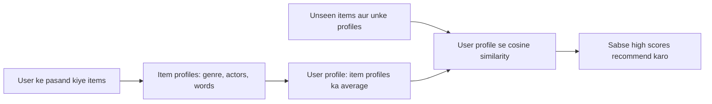

**In simple words:** product ki **properties** ke base pe recommend karna **content-based recommendation** kehlata hai. Hum har item ko uski properties se describe karte hain (movie ke liye: genre, actors, director), user ne jo items high rate kiye unse seekhte hain ki user ko kaunsi properties pasand hain, aur aise naye items recommend karte hain jinki properties match karti hain. <Cite id="recommendation-systems-mmds-book" loc="§9.2" /> <Cite id="recommendation-systems-gfg-cb" />

**Ye kyun zaroori hai:** site mein lakhon items hote hain aur user ne sirf kuch dekhe hote hain. Humein andaza lagana hai ki user ko kaunse unseen items pasand aayenge, chahe kisi aur user ne unhe rate na kiya ho.

**Kaise kaam karta hai**

1. **Item profile.** Har item ko uski properties ke vector ki tarah likho, jaise movie mein wo genre ho to 1, nahi to 0. Text items ke liye important words (TF-IDF) use karo.
2. **User profile.** User ne jo items pasand kiye unke profiles ko combine karo, aam taur pe average se.
3. **Match.** User profile aur har unseen item ke profile ki similarity (cosine) nikalo.
4. **Recommend** karo sabse high similarity wale items. <Cite id="recommendation-systems-google-cb" />

<Cite id="recommendation-systems-gfg-cb" loc="diagram" />

<Sum>

<Given>

Properties (Action, Sci-Fi, Romance, Comedy), 1 matlab movie mein hai. User ko movie A $= (1, 1, 0, 0)$ aur movie B $= (1, 0, 0, 0)$ pasand aayi. Unseen movies: X $= (1, 1, 0, 0)$, Y $= (0, 0, 1, 1)$, Z $= (1, 0, 1, 0)$.

</Given>

<Find>

kaunsi unseen movie pehle recommend karni hai.

</Find>

<Steps>

1. **User profile** $=$ A aur B ka average $= \big((1+1)/2, (1+0)/2, 0, 0\big) = (1, 0.5, 0, 0)$. *Reason: isse dikhta hai ki user ko Action poora aur Sci-Fi aadhe samay pasand hai.*
2. **Profile ki length** $= \sqrt{1^2 + 0.5^2} = \sqrt{1.25} = 1.118$.
3. **Cosine similarity** $= \dfrac{\text{profile} \cdot \text{item}}{|\text{profile}|\,|\text{item}|}$:

   | Movie | Profile ke saath dot product | Movie ki length | Cosine |
   |---|---|---|---|
   | X $(1,1,0,0)$ | $1 + 0.5 = 1.5$ | $\sqrt{2} = 1.414$ | $1.5 / (1.118 \times 1.414) = 0.949$ |
   | Z $(1,0,1,0)$ | $1$ | $\sqrt{2} = 1.414$ | $1 / (1.118 \times 1.414) = 0.632$ |
   | Y $(0,0,1,1)$ | $0$ | $\sqrt{2} = 1.414$ | $0$ |

4. **Rank:** X (0.949), phir Z (0.632), phir Y (0).

</Steps>

<Answer>

movie X pehle recommend karo, phir Z. Movie Y user ke taste se kuch share nahi karti, isliye recommend nahi karni.

</Answer>

<Box kind="verify">

Check 1: $1.118 \times 1.414 = 1.581$, aur $1.5 / 1.581 = 0.949$ tatha $1 / 1.581 = 0.632$. Saath hi $|\text{profile}| \times |X| = \sqrt{1.25 \times 2} = \sqrt{2.5} = 1.581$, same.

Check 2: X mein bilkul wahi properties hain jo pasand ki hui movie A mein, to uska score sabse high hona chahiye. Y mein koi common property nahi, to uska dot product 0 hona chahiye, aur hai.

</Box>

</Sum>

**Advantages:** dusre users ki zaroorat nahi, isliye naye ya unpopular item ke liye bhi kaam karta hai; reason samjhana aasan hai ("same genre"); user ke unusual taste ko respect kar sakta hai. **Disadvantages:** har item ki achhi properties chahiye; wahi type ke items baar baar recommend karta hai (surprise nahi); bina history wale naye user ka profile nahi hota. <Cite id="recommendation-systems-wiki-recsys" />

**Applications:** movie aur music sites (genre, artist), news aur article feeds (keywords).

**Conclusion:** content-based recommendation product ki properties ko user ke profile se match karta hai, jo pasand kiye items se bana hai; yahan movie X sabse achhi hai.

Exam mein English mein likho: "In content-based recommendation, item profiles are built from product properties, a user profile is built from liked items, and items with the highest cosine similarity to the user profile are recommended."
