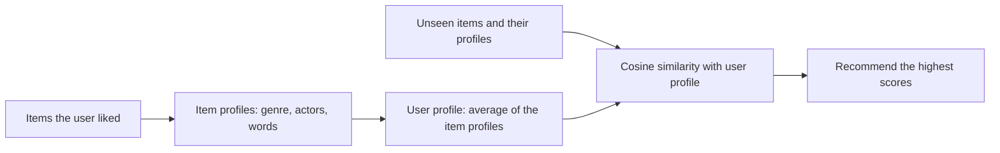

**In simple words:** recommending by the **properties of the product** is called **content-based recommendation**. We describe every item by its properties (for a movie: genre, actors, director), learn what properties the user liked from the items they rated highly, and recommend new items whose properties match. <Cite id="recommendation-systems-mmds-book" loc="§9.2" /> <Cite id="recommendation-systems-gfg-cb" />

**Why it is needed:** a site has millions of items and a user has seen only a few. We need to guess which unseen items the user will like, even when no other user has rated them.

**How it works**

1. **Item profile.** Write each item as a vector of its properties, for example 1 if the movie has that genre, else 0. For text items, use important words (TF-IDF).
2. **User profile.** Combine the profiles of the items the user liked, usually by averaging them.
3. **Match.** Compute the similarity (cosine) between the user profile and each unseen item's profile.
4. **Recommend** the items with the highest similarity. <Cite id="recommendation-systems-google-cb" />

<Cite id="recommendation-systems-gfg-cb" loc="diagram" />

<Sum>

<Given>

Properties (Action, Sci-Fi, Romance, Comedy), 1 means the movie has it. The user liked movie A $= (1, 1, 0, 0)$ and movie B $= (1, 0, 0, 0)$. Unseen movies: X $= (1, 1, 0, 0)$, Y $= (0, 0, 1, 1)$, Z $= (1, 0, 1, 0)$.

</Given>

<Find>

which unseen movie to recommend first.

</Find>

<Steps>

1. **User profile** $=$ average of A and B $= \big((1+1)/2, (1+0)/2, 0, 0\big) = (1, 0.5, 0, 0)$. *Reason: it shows the user likes Action fully and Sci-Fi half the time.*
2. **Length of the profile** $= \sqrt{1^2 + 0.5^2} = \sqrt{1.25} = 1.118$.
3. **Cosine similarity** $= \dfrac{\text{profile} \cdot \text{item}}{|\text{profile}|\,|\text{item}|}$:

   | Movie | Dot product with profile | Length of movie | Cosine |
   |---|---|---|---|
   | X $(1,1,0,0)$ | $1 + 0.5 = 1.5$ | $\sqrt{2} = 1.414$ | $1.5 / (1.118 \times 1.414) = 0.949$ |
   | Z $(1,0,1,0)$ | $1$ | $\sqrt{2} = 1.414$ | $1 / (1.118 \times 1.414) = 0.632$ |
   | Y $(0,0,1,1)$ | $0$ | $\sqrt{2} = 1.414$ | $0$ |

4. **Rank:** X (0.949), then Z (0.632), then Y (0).

</Steps>

<Answer>

recommend movie X first, then Z. Movie Y shares nothing with the user's taste, so do not recommend it.

</Answer>

<Box kind="verify">

Check 1: $1.118 \times 1.414 = 1.581$, and $1.5 / 1.581 = 0.949$ and $1 / 1.581 = 0.632$. Also $|\text{profile}| \times |X| = \sqrt{1.25 \times 2} = \sqrt{2.5} = 1.581$, the same.

Check 2: X has exactly the properties of liked movie A, so it should score highest. Y has no property in common, so its dot product must be 0, and it is.

</Box>

</Sum>

**Advantages:** needs no other users, so it works for a new or unpopular item; the reason is easy to explain ("same genre"); it can respect a user's unusual taste. **Disadvantages:** it needs good properties for every item; it keeps recommending the same kind of item (no surprise); a new user with no history has no profile. <Cite id="recommendation-systems-wiki-recsys" />

**Applications:** movie and music sites (genre, artist), news and article feeds (keywords).

**Conclusion:** content-based recommendation matches the properties of a product with the user's profile built from liked items; here movie X is best.
