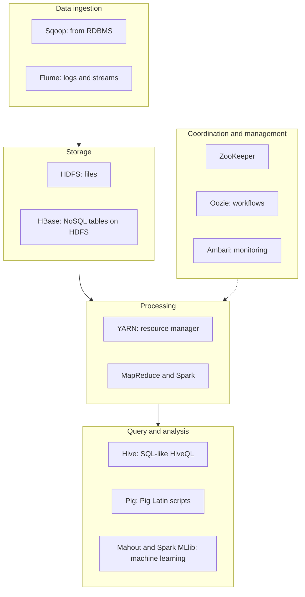

**In simple words:** Hadoop ecosystem Hadoop core ke aas-paas bane tools ka parivaar hai. Core data store aur process karta hai, par real project ko loading, querying, scheduling aur coordination bhi chahiye, aur har tool ek gap bharta hai. <Cite id="hadoop-ecosystem-gfg-hadoop-ecosystem" /> <Cite id="hadoop-ecosystem-av-hadoop-ecosystem" />

<Cite id="hadoop-ecosystem-gfg-hadoop-ecosystem" loc="diagram" />

| Component | Kya karta hai |
|---|---|
| **HDFS** | Bade files ko replicated blocks mein cluster pe store karta hai. |
| **YARN** | Cluster ki CPU aur memory applications mein baantta hai. |
| **MapReduce** | Map, shuffle, reduce steps mein batch processing. |
| **Hive** | HDFS data pe SQL-like queries (HiveQL), jo jobs mein badal jaati hain. |
| **Pig** | Lambe Java code ki jagah Pig Latin mein data-flow scripts. |
| **HBase** | HDFS pe column-oriented NoSQL database, single-row fast read/write ke liye. |
| **Spark** | Fast in-memory engine: iterative jobs, machine learning, streaming. |
| **Mahout** | Scalable machine learning (recommendation, clustering). |
| **ZooKeeper** | Coordination: configuration, naming, locks, leader election. |
| **Oozie** | Jobs ki chain (workflow) sahi order mein chalata hai. |
| **Sqoop** | Relational databases aur HDFS ke beech bulk copy. |
| **Flume** | Logs jaisa streaming data HDFS mein collect karta hai. |
| **Ambari** | Cluster set up aur monitor karne ka web tool. |

<Cite id="hadoop-ecosystem-apache-hive" /> <Cite id="hadoop-ecosystem-apache-hbase" /> <Cite id="hadoop-ecosystem-apache-zookeeper" />

**Conclusion:** core storage, resources aur processing deta hai, aur ecosystem tools loading, querying, scheduling aur analysis aasan banate hain. Sqoop jaise kuch tools ab retired ya kam use hote hain, par exams mein classic list hi poochhi jaati hai. <Cite id="hadoop-ecosystem-apache-hadoop" />
