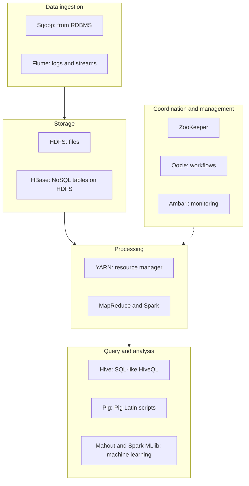

**In simple words:** the Hadoop ecosystem is the family of tools built around the Hadoop core. The core stores and processes data, but a real project also needs loading, querying, scheduling and coordination, and each tool fills one of those gaps. <Cite id="hadoop-ecosystem-gfg-hadoop-ecosystem" /> <Cite id="hadoop-ecosystem-av-hadoop-ecosystem" />

<Cite id="hadoop-ecosystem-gfg-hadoop-ecosystem" loc="diagram" />

| Component | What it does |
|---|---|
| **HDFS** | Stores big files as replicated blocks across the cluster. |
| **YARN** | Shares CPU and memory of the cluster between applications. |
| **MapReduce** | Batch processing in map, shuffle and reduce steps. |
| **Hive** | SQL-like queries (HiveQL) on data in HDFS, turned into jobs. |
| **Pig** | Data-flow scripts in Pig Latin instead of long Java code. |
| **HBase** | Column-oriented NoSQL database on HDFS for fast single-row reads and writes. |
| **Spark** | Fast in-memory engine for iterative jobs, machine learning and streaming. |
| **Mahout** | Scalable machine learning (recommendation, clustering). |
| **ZooKeeper** | Coordination: configuration, naming, locks, leader election. |
| **Oozie** | Runs a chain of jobs (workflow) in the right order. |
| **Sqoop** | Bulk copy between relational databases and HDFS. |
| **Flume** | Collects streaming data such as logs into HDFS. |
| **Ambari** | Web tool to set up and monitor the cluster. |

<Cite id="hadoop-ecosystem-apache-hive" /> <Cite id="hadoop-ecosystem-apache-hbase" /> <Cite id="hadoop-ecosystem-apache-zookeeper" />

**Conclusion:** the core gives storage, resources and processing, and the ecosystem tools make loading, querying, scheduling and analysing easy. Some tools, such as Sqoop, are now retired or less used, but exams still ask the classic list. <Cite id="hadoop-ecosystem-apache-hadoop" />
