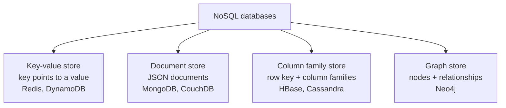

**In simple words:** NoSQL ("not only SQL") databases fixed tables ke bina data store karte hain aur bahut si sasti nodes pe scale out hote hain. Chaar main types ka fark stored data ke shape mein hai. <Cite id="nosql-patterns-gfg-types" /> <Cite id="nosql-intro-fowler-agg" />

<Cite id="nosql-patterns-gfg-types" loc="diagram" />

1. **Key-value store.** Bade dictionary jaisa: unique key ek value ko point karti hai jiske andar database nahi dekhta. Bahut fast aur simple, sirf key se look-up. Cache, sessions aur shopping cart mein use hota hai. Example: Redis. <Cite id="nosql-patterns-redis-kv" />
2. **Document store.** Har record ek self-describing JSON ya XML document hai, aur alag documents mein alag fields ho sakte hain. Kisi bhi field se query kar sakte hain. Product catalogue, user profile, content mein use hota hai. Example: MongoDB. <Cite id="nosql-patterns-mongo-doc" />
3. **Column family store.** Data row key ke neeche column families mein group hota hai, timestamped cells ke saath. Bahut bada sparse data kai nodes pe sambhalta hai. Time series, logs, messaging mein use hota hai. Examples: HBase, Cassandra. <Cite id="nosql-patterns-hbase-book" />
4. **Graph store.** Data nodes hai jo relationships se jude hain, aur dono ki properties ho sakti hain. Links follow karna fast hai. Social networks, fraud detection, recommendations mein use hota hai. Example: Neo4j. <Cite id="nosql-patterns-neo4j-model" />

| Point | Key-value | Document | Column family | Graph |
|---|---|---|---|---|
| Data shape | Key to opaque value | JSON document | Row key, column families | Nodes and edges |
| Query by | Key only | Key and any field | Row key, column ranges | Traversal of links |
| Best for | Cache, sessions | Catalogues, profiles | Huge sparse data, logs | Connected data |
| Weak at | Searching inside values | Joins | Ad-hoc queries | Bulk storage, scaling out |

**Conclusion:** har type query power aur scale ka trade-off alag tarah se karta hai, isliye main access pattern dekhkar chuno.
