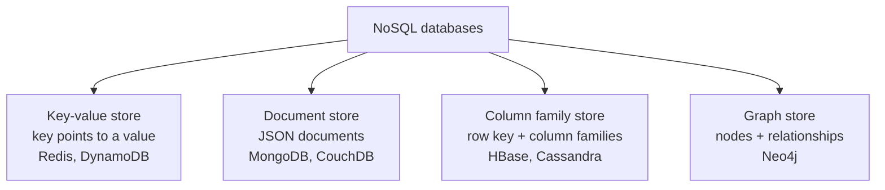

**In simple words:** NoSQL ("not only SQL") databases store data without fixed tables and scale out over many cheap nodes. The four main types differ in the shape of the stored data. <Cite id="nosql-patterns-gfg-types" /> <Cite id="nosql-intro-fowler-agg" />

<Cite id="nosql-patterns-gfg-types" loc="diagram" />

1. **Key-value store.** Like a big dictionary: a unique key points to a value that the database does not look inside. Very fast and simple, with look-up by key only. Used for cache, sessions and shopping carts. Example: Redis. <Cite id="nosql-patterns-redis-kv" />
2. **Document store.** Each record is a self-describing JSON or XML document, and different documents can have different fields. We can query by any field. Used for product catalogues, user profiles and content. Example: MongoDB. <Cite id="nosql-patterns-mongo-doc" />
3. **Column family store.** Data sits under a row key, grouped into column families, with timestamped cells. It handles huge sparse data across many nodes. Used for time series, logs and messaging. Examples: HBase, Cassandra. <Cite id="nosql-patterns-hbase-book" />
4. **Graph store.** Data is nodes joined by relationships, and both can carry properties. Following links is fast. Used for social networks, fraud detection and recommendations. Example: Neo4j. <Cite id="nosql-patterns-neo4j-model" />

| Point | Key-value | Document | Column family | Graph |
|---|---|---|---|---|
| Data shape | Key to opaque value | JSON document | Row key, column families | Nodes and edges |
| Query by | Key only | Key and any field | Row key, column ranges | Traversal of links |
| Best for | Cache, sessions | Catalogues, profiles | Huge sparse data, logs | Connected data |
| Weak at | Searching inside values | Joins | Ad-hoc queries | Bulk storage, scaling out |

**Conclusion:** each type trades query power for scale in a different way, so choose by the main access pattern.
