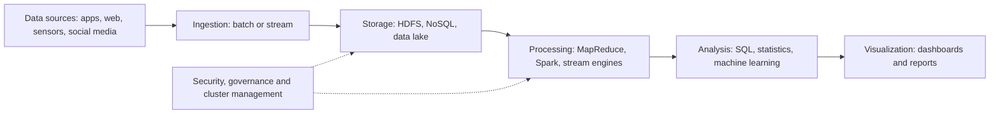

**In simple words:** big data wo data hai jo ek ordinary database ke liye bahut bada, tez aur mixed hai. Uski architecture layers ka set hai jinse data wahan se jahan paida hota hai wahan tak jaata hai jahan log use karte hain. <Cite id="big-data-intro-ibm" /> <Cite id="big-data-intro-gfg" />

<Cite id="big-data-intro-gfg" loc="diagram" /> <Cite id="big-data-intro-aws" />

**Layers.** Koi ek official design nahi hai; ye common view hai.

1. **Data sources:** apps, web, sensors, social media, logs, databases.
2. **Ingestion:** data ko andar laata hai, batches mein ya stream ki tarah.
3. **Storage:** HDFS jaisa distributed file system, NoSQL databases ya data lake.
4. **Processing:** batch (MapReduce, Spark) ya stream processing.
5. **Analysis:** SQL-style queries, statistics aur machine learning.
6. **Visualization:** dashboards aur reports.
7. **Saari layers ke across:** security, governance aur resource management.

**Characteristics (the Vs).**

| V | Meaning | Example |
|---|---|---|
| Volume | Data ki matra: terabytes to petabytes. | Roz upload hone wali photos. |
| Velocity | Aane aur process hone ki speed. | Stock ticks, live clicks. |
| Variety | Structured, semi-structured, unstructured forms. | Tweets, video, bank tables. |
| Veracity | Data kitna trustworthy aur clean hai. | Fake reviews, faulty sensors. |
| Value | Data se milne wala useful insight. | Sales badhane wale recommendations. |

Volume, Velocity aur Variety original teen Vs hain; Veracity aur Value baad mein jode gaye. <Cite id="big-data-intro-mmds" /> <Cite id="big-data-intro-wiki" />

**Conclusion:** layered architecture characteristics ko handle karti hai: storage aur processing layers volume aur velocity sambhalti hain, aur flexible formats variety.
