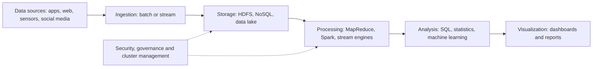

**In simple words:** big data is data too large, too fast and too mixed for one ordinary database. Its architecture is a set of layers through which data flows from where it is born to where people use it. <Cite id="big-data-intro-ibm" /> <Cite id="big-data-intro-gfg" />

<Cite id="big-data-intro-gfg" loc="diagram" /> <Cite id="big-data-intro-aws" />

**The layers.** There is no single official design; this is the common view.

1. **Data sources:** apps, web, sensors, social media, logs, databases.
2. **Ingestion:** brings data in, either in batches or as a stream.
3. **Storage:** a distributed file system such as HDFS, NoSQL databases or a data lake.
4. **Processing:** batch (MapReduce, Spark) or stream processing.
5. **Analysis:** SQL-style queries, statistics and machine learning.
6. **Visualization:** dashboards and reports.
7. **Across all layers:** security, governance and resource management.

**Characteristics (the Vs).**

| V | Meaning | Example |
|---|---|---|
| Volume | Amount of data: terabytes to petabytes. | Photos uploaded daily. |
| Velocity | Speed of arrival and processing. | Stock ticks, live clicks. |
| Variety | Structured, semi-structured and unstructured forms. | Tweets, video, bank tables. |
| Veracity | How trustworthy and clean the data is. | Fake reviews, faulty sensors. |
| Value | The useful insight the data finally gives. | Recommendations that raise sales. |

Volume, Velocity and Variety are the original three Vs; Veracity and Value were added later. <Cite id="big-data-intro-mmds" /> <Cite id="big-data-intro-wiki" />

**Conclusion:** the layered architecture handles the characteristics: storage and processing layers cope with volume and velocity, and flexible formats cope with variety.
