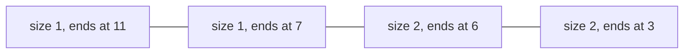

**In simple words:** DGIM (Datar, Gionis, Indyk, Motwani, 2002) 0/1 stream ke last $k$ bits mein 1s ginta hai, poori window ki jagah sirf kuch chhote buckets use karke. Answer approximate hota hai par 50 percent se zyada galat kabhi nahi. <Cite id="stream-counting-mmds-home" loc="§4.6" /> <Cite id="stream-counting-wiki-dsm" />

**Ye kyun zaroori hai.** $N$ bits ki window ka exact count ke liye saare $N$ bits store karne padte hain, kyunki window se nikalne wala bit 1 tha ya nahi ye jaanna padta hai. $N$ = 1 billion aur bahut saari streams ho to ye bahut zyada hai. DGIM ko sirf lagbhag $O(\log^2 N)$ bits chahiye. <Cite id="stream-counting-wiki-streaming" />

**Buckets.** Bucket apna **size** (1s ki ginti) aur **right end ka timestamp** rakhta hai. Rules:

1. Bucket ka right end hamesha 1 hota hai.
2. Har 1 kisi bucket mein hota hai, aur koi position do buckets mein nahi hoti.
3. Sizes powers of 2 hote hain.
4. Har size ke ek ya do buckets hote hain.
5. Peeche jaate hue sizes kabhi kam nahi hote.
6. Bucket tab drop hota hai jab uska right end window se bahar chala jaaye.

**Naye bit pe update** time $t$ par: sabse purana bucket window se bahar ho to hata do. 0 aaye to kuch nahi badalta. 1 aaye to bucket (1, $t$) banta hai. Agar ek size ke teen buckets ho jaayein to do sabse purane merge karke double size ka bucket banao, newer timestamp rakhte hue; agle size ke liye repeat karo.

**Last $k$ bits ka query:** window ko overlap karne wale sabse purane bucket $B$ se newer saare buckets ke sizes jodo, phir $B$ ke size ka **aadha** jodo. <Cite id="stream-counting-cs246-slides" />

<Sum>

<Given>

Stream (time 1 pehle): `1 0 1 1 0 1 1 0 0 0 1` (11 bits). Window $N = 16$ (abhi kuch drop nahi hota).

</Given>

<Find>

buckets, aur last 8 bits mein 1s ka estimate.

</Find>

<Steps>

1. Buckets ko (size, right-end time) likho, newest pehle. Zeros kuch nahi badalte.
   - $t=1$: (1,1). $t=3$: (1,3) (1,1).
   - $t=4$: size 1 ke teen, to do sabse purane merge: (1,4) (2,3).
   - $t=6$: (1,6) (1,4) (2,3).
   - $t=7$: size 1 ke teen, (1,6) aur (1,4) ko (2,6) mein merge: (1,7) (2,6) (2,3).
   - $t=11$: (1,11) (1,7) (2,6) (2,3).
2. Last 8 bits time 4 se 11 hain. Overlap karne wala sabse purana bucket $B$ = (2,6) hai, kyunki (2,3) 3 pe khatam hota hai, bahar.
3. $B$ se newer buckets: $1 + 1 = 2$. $B$ ka aadha: $2/2 = 1$. Estimate $= 2 + 1 = 3$.

</Steps>

<Answer>

last 8 bits mein estimate $= 3$ ones (true count 4).

</Answer>

<Box kind="verify">

Time 4 se 11 tak seedhi ginti: 1s at 4, 6, 7 aur 11, yaani 4. Error $= 1/4 = 25$ percent, 50 percent bound ke andar. Buckets rules follow karte hain: sizes 1, 1, 2, 2 peeche jaate hue kam nahi hote aur har right end (11, 7, 6, 3) 1 hai. Buckets mein total 1s $= 1+1+2+2 = 6$, stream ke chhe 1s se match karta hai.

</Box>

</Sum>

**Advantages:** bahut kam memory, fast update, guaranteed error. **Limits:** sirf approximate; har size ke $r$ tak buckets rakhne se error lagbhag $1/(r-1)$ tak ghat jaata hai.
