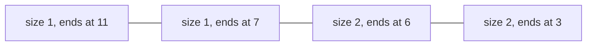

**In simple words:** DGIM (Datar, Gionis, Indyk, Motwani, 2002) counts the 1s among the last $k$ bits of a 0/1 stream using only a few small buckets instead of the whole window. The answer is approximate but never more than 50 percent wrong. <Cite id="stream-counting-mmds-home" loc="§4.6" /> <Cite id="stream-counting-wiki-dsm" />

**Why it is needed.** An exact count over a window of $N$ bits needs all $N$ bits stored, because we must know whether the bit leaving the window was a 1. For $N$ = 1 billion, and many streams, this is too much. DGIM needs only about $O(\log^2 N)$ bits. <Cite id="stream-counting-wiki-streaming" />

**Buckets.** A bucket stores its **size** (number of 1s) and the **timestamp of its right end**. The rules:

1. The right end of a bucket is a 1.
2. Every 1 is in some bucket, and no position is in two buckets.
3. Sizes are powers of 2.
4. There are one or two buckets of each size.
5. Going back in time, sizes never decrease.
6. A bucket is dropped when its right end leaves the window.

**Update for a new bit** at time $t$: drop the oldest bucket if it is out of the window. A 0 changes nothing. A 1 creates a bucket (1, $t$). If three buckets of one size now exist, merge the two oldest into one of double size, keeping the newer timestamp; repeat for the next size.

**Query for the last $k$ bits:** add the sizes of all buckets newer than the oldest bucket $B$ that overlaps the window, then add **half** of $B$'s size. <Cite id="stream-counting-cs246-slides" />

<Sum>

<Given>

Stream (time 1 first): `1 0 1 1 0 1 1 0 0 0 1` (11 bits). Window $N = 16$ (so nothing is dropped yet).

</Given>

<Find>

the buckets, and the estimate of the 1s in the last 8 bits.

</Find>

<Steps>

1. Write buckets as (size, right-end time), newest first. Zeros change nothing.
   - $t=1$: (1,1). $t=3$: (1,3) (1,1).
   - $t=4$: three of size 1, so merge the two oldest: (1,4) (2,3).
   - $t=6$: (1,6) (1,4) (2,3).
   - $t=7$: three of size 1, merge (1,6) and (1,4) into (2,6): (1,7) (2,6) (2,3).
   - $t=11$: (1,11) (1,7) (2,6) (2,3).
2. The last 8 bits are times 4 to 11. The oldest bucket that overlaps is $B$ = (2,6), because (2,3) ends at 3, outside.
3. Buckets newer than $B$: $1 + 1 = 2$. Half of $B$: $2/2 = 1$. Estimate $= 2 + 1 = 3$.

</Steps>

<Answer>

estimate $= 3$ ones in the last 8 bits (true count 4).

</Answer>

<Box kind="verify">

Direct count of times 4 to 11: 1s at 4, 6, 7 and 11, so 4. Error $= 1/4 = 25$ percent, inside the 50 percent bound. The buckets obey the rules: sizes 1, 1, 2, 2 never decrease backwards and every right end (11, 7, 6, 3) is a 1. Total 1s in buckets $= 1+1+2+2 = 6$ matches the six 1s in the stream.

</Box>

</Sum>

**Advantages:** tiny memory, fast update, guaranteed error. **Limits:** approximate only; keeping up to $r$ buckets per size cuts the error to about $1/(r-1)$.
