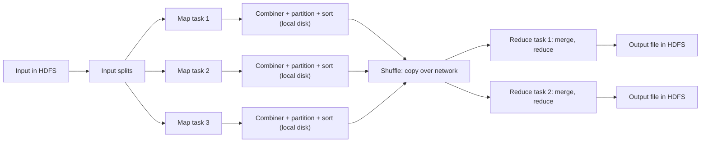

**In simple words:** MapReduce job ek fixed pipeline se guzarta hai: input split hota hai, map tasks use (key, value) pairs mein badalte hain, pairs key ke hisaab se group hote hain (shuffle), aur reduce tasks har group ko final answer mein combine karte hain. <Cite id="mapreduce-gfg-mr" /> <Cite id="hadoop-ecosystem-dean2004" />

<Cite id="mapreduce-gfg-mr" loc="diagram" /> <Cite id="mapreduce-tpoint" loc="diagram" />

**Main components.**

| Component | Function |
|---|---|
| Client | Map aur reduce code package karta hai, input/output paths batata hai, job submit karta hai. |
| Resource manager (YARN ResourceManager) | Cluster resources deta hai aur free nodes dhundta hai, preferably data ke paas. |
| Job master (MRAppMaster) | Ek job chalata hai: map aur reduce tasks banata hai, assign karta hai, progress track karta hai, failed tasks restart karta hai. |
| Workers (NodeManagers) | Map aur reduce tasks chalate hain aur heartbeats bhejte hain. |
| InputFormat and RecordReader | Input ko splits mein kaatte hain aur har ek ko (key, value) records banate hain. |
| Mapper | Har record pe map function chalata hai. |
| Combiner (optional) | Network se pehle map output chhota karne ke liye mini reduce. |
| Partitioner | Har key ke liye reducer chunta hai, $\text{hash}(key) \bmod R$. |
| Shuffle and sort | Har reducer ke buckets saare mappers se copy karta hai aur sorted key groups mein merge karta hai. |
| Reducer | Har key group pe reduce function chalata hai. |
| OutputFormat and HDFS | Result likhte hain, har reducer ki ek file. |

<Cite id="mapreduce-tp" /> <Cite id="hadoop-ecosystem-apache-mr-tutorial" />

**Execution ka order.** Submit, split, schedule, map (output local disk pe spill), shuffle, sort and merge, reduce, HDFS mein write. Reduce function tabhi shuru hota hai jab saare maps khatam ho jaayein, kyunki ek key abhi unfinished map mein aa sakti hai.

**Conclusion:** pipeline splitting, scheduling, grouping aur failures framework sambhalta hai, isliye programmer sirf map aur reduce likhta hai.
