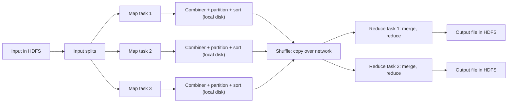

**In simple words:** a MapReduce job passes through a fixed pipeline: the input is split, map tasks turn it into (key, value) pairs, the pairs are grouped by key (shuffle), and reduce tasks combine each group into the final answer. <Cite id="mapreduce-gfg-mr" /> <Cite id="hadoop-ecosystem-dean2004" />

<Cite id="mapreduce-gfg-mr" loc="diagram" /> <Cite id="mapreduce-tpoint" loc="diagram" />

**Main components.**

| Component | Function |
|---|---|
| Client | Packages the map and reduce code, names input and output paths, submits the job. |
| Resource manager (YARN ResourceManager) | Gives out cluster resources and finds free nodes, preferably near the data. |
| Job master (MRAppMaster) | Runs one job: creates map and reduce tasks, assigns them, tracks progress, restarts failed tasks. |
| Workers (NodeManagers) | Run the map and reduce tasks and send heartbeats. |
| InputFormat and RecordReader | Cut the input into splits and turn each into (key, value) records. |
| Mapper | Runs the map function on each record. |
| Combiner (optional) | A mini reduce on map output to shrink it before the network. |
| Partitioner | Picks the reducer for each key, $\text{hash}(key) \bmod R$. |
| Shuffle and sort | Copies each reducer's buckets from all mappers and merges them into sorted key groups. |
| Reducer | Runs the reduce function on each key group. |
| OutputFormat and HDFS | Write the result, one file per reducer. |

<Cite id="mapreduce-tp" /> <Cite id="hadoop-ecosystem-apache-mr-tutorial" />

**Order of execution.** Submit, split, schedule, map (output spilled to local disk), shuffle, sort and merge, reduce, write to HDFS. The reduce function starts only after all maps finish, because a key may still appear in an unfinished map.

**Conclusion:** the pipeline lets the framework handle splitting, scheduling, grouping and failures, so the programmer writes only map and reduce.
