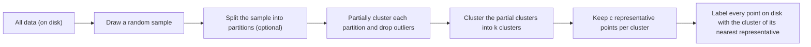

**In simple words:** CURE (Clustering Using REpresentatives, Guha, Rastogi aur Shim, 1998) bade data ke liye hierarchical clustering method hai. Ye har cluster ko kuch well-scattered points se describe karta hai, jinhe centre ki taraf thoda khiskaya jaata hai, aur unhi se merge decide karta hai. <Cite id="cure-stream-clustering-guha1998" loc="§1.2" /> <Cite id="cure-stream-clustering-wiki-cure" />

**Ye kyun zaroori hai.** K-means aur centroid methods round, barabar size ke clusters pasand karte hain aur lambe ya bade clusters ko tod dete hain. Saare points use karne se ek stray point ya patla bridge clusters ko galat jod deta hai. CURE dono ke beech hai: kuch representatives shape pakadte hain aur fast hain. <Cite id="cure-stream-clustering-guha1998" loc="§1.1" />

**Steps** (Euclidean space). <Cite id="distance-measures-mmds" loc="ch. 7" />

1. Memory mein fit hone wala random sample lo.
2. Sample ko hierarchically cluster karo (sabse paas wali jodi baar baar merge) jab tak $k$ clusters bachein.
3. Har cluster mein $c$ well-scattered points chuno: pehla centroid se sabse door, har agla pehle chune hue points se sabse door.
4. Har point ko centroid ki taraf fraction $\alpha$ shrink karo, $p_{\text{new}} = p + \alpha(\text{centroid} - p)$. Door ke outliers sabse zyada hilte hain.
5. Do clusters ki distance unke sabse paas wale representatives ki distance hai. Sabse paas ke do merge karo aur naye representatives chuno.
6. Poora data ek baar scan karo aur har point ko uske nearest representative ke cluster mein daalo.

<Cite id="cure-stream-clustering-gfg-cure" loc="diagram" />

| Advantages | Disadvantages |
|---|---|
| Lambe ya curved clusters milte hain, sirf round nahi | Euclidean space chahiye (centroids use hote hain) |
| Bahut alag sizes ke clusters handle karta hai | $c$, $\alpha$, sample size aur $k$ pe depend karta hai |
| Outliers se kam affected | Chhota sample chhote cluster ko miss kar sakta hai |
| Sampling aur partitioning se scale hota hai | High dimensions mein bahut distance computations |

<Cite id="cure-stream-clustering-tp-cure" />

**Conclusion:** CURE aksar k-means ya BIRCH se behtar shape ke clusters deta hai, bas kuch parameters tune karne padte hain.
