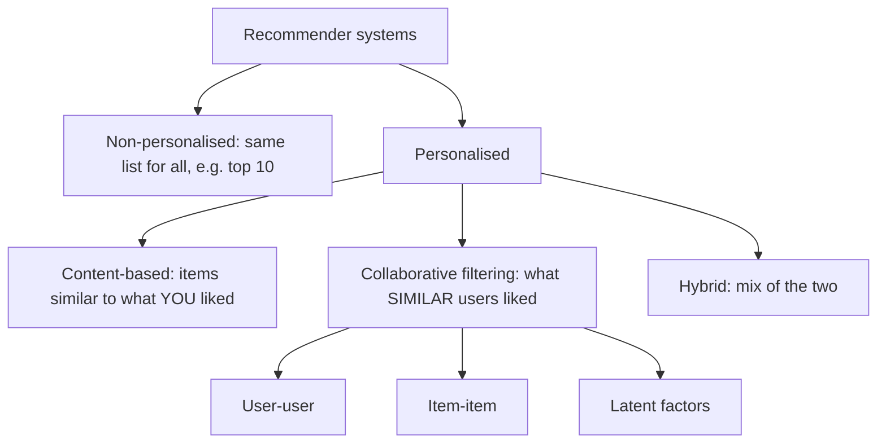

**In simple words:** recommender system ek software hai jo predict karta hai ki user ko wo items kitne pasand aayenge jo usne abhi try nahi kiye, aur best kuch dikhata hai. Ye us dost jaisa hai jo tumhari pasand jaanta hai, par millions logon ke liye ek saath. <Cite id="recommendation-systems-wiki-recsys" /> <Cite id="recommendation-systems-ibm" />

**Ye kyun zaroori hai.** Online shop lakhon items list kar sakta hai, jitna koi browse nahi kar sakta. Kam bikne wale items long tail hain. Recommender har insaan ko wo tail items dikhata hai jo use pasand aayenge, jisse sales aur satisfaction badhte hain. Examples: Amazon products, Netflix films, YouTube videos, Spotify songs. <Cite id="recommendation-systems-mmds-slides" /> <Cite id="recommendation-systems-wiki-longtail" />

<Cite id="recommendation-systems-ibm" loc="diagram" /> <Cite id="recommendation-systems-google-types" />

**Types.**

1. **Content-based.** User ko wo items recommend karta hai jo uske pasand kiye items jaise hon, item properties (genre, actors, important words) se judge karke. Steps: item profiles banao, pasand kiye items se user profile banao, phir best match karne wale naye items recommend karo (jaise cosine similarity se). <Cite id="recommendation-systems-google-types" />
2. **Collaborative filtering.** Sirf bahut se users ki ratings use karta hai. Similar rating pattern wale users (ya items) dhundta hai aur unki ratings se predict karta hai: "tumhare jaise logon ko ye pasand aaya". Items ke baare mein kuch jaane bina bhi chalta hai. <Cite id="recommendation-systems-av" />
3. **Hybrid.** Dono combine karta hai taaki ek dusre ki kamzori cover ho. Netflix aur YouTube aisa karte hain.

| Type | Uses | Weakness |
|---|---|---|
| Content-based | Item properties and user's own history | Achhe features chahiye; sirf similar cheezein recommend karta hai |
| Collaborative | Ratings of many users | Cold start: naye users aur naye items |
| Hybrid | Both | Zyada complex |

**Conclusion:** content-based poochta hai "ye item kaisa hai?", collaborative poochta hai "ye user kiske jaisa hai?", aur hybrid dono use karta hai.
