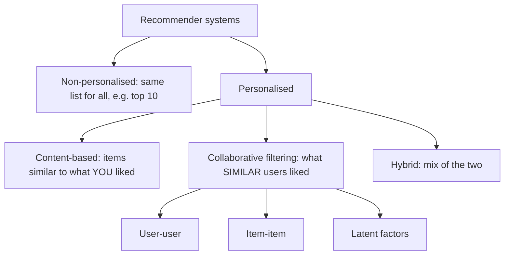

**In simple words:** a recommender system is software that predicts how much a user will like items they have not tried yet and shows the best few. It is like a friend who knows your taste, working for millions of people at once. <Cite id="recommendation-systems-wiki-recsys" /> <Cite id="recommendation-systems-ibm" />

**Why it is needed.** An online shop can list millions of items, far more than anyone can browse. The rarely bought items are the long tail. A recommender connects each person to the tail items they would like, which raises sales and satisfaction. Examples: Amazon products, Netflix films, YouTube videos, Spotify songs. <Cite id="recommendation-systems-mmds-slides" /> <Cite id="recommendation-systems-wiki-longtail" />

<Cite id="recommendation-systems-ibm" loc="diagram" /> <Cite id="recommendation-systems-google-types" />

**Types.**

1. **Content-based.** Recommends items similar to what the user liked, judged by item properties such as genre, actors or important words. Steps: build item profiles, build a user profile from the liked items, then recommend the new items that match best (for example by cosine similarity). <Cite id="recommendation-systems-google-types" />
2. **Collaborative filtering.** Uses only the ratings of many users. It finds users (or items) with similar rating patterns and predicts from their ratings: "people like you liked this". It works without knowing anything about the items. <Cite id="recommendation-systems-av" />
3. **Hybrid.** Combines both so that each covers the other's weakness. Netflix and YouTube do this.

| Type | Uses | Weakness |
|---|---|---|
| Content-based | Item properties and the user's own history | Needs good features; recommends only similar things |
| Collaborative | Ratings of many users | Cold start: new users and new items |
| Hybrid | Both | More complex |

**Conclusion:** content-based asks "what is this item like?", collaborative asks "who is like this user?", and hybrid uses both.
