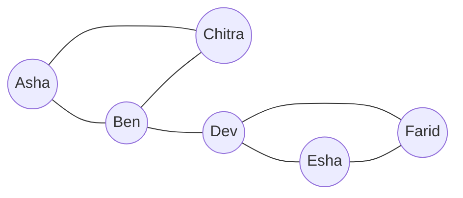

**In simple words:** social network actors (log, accounts, companies) ka set hai aur unke beech ke relationships. Kai real networks mein locality bhi dikhti hai: A, B aur C ko jaanta hai to B aur C ke ek dusre ko jaanne ke chance zyada hote hain. <Cite id="social-network-graphs-wiki-social-network" /> <Cite id="social-network-graphs-mmds-book" /> <Cite id="social-network-graphs-wiki-homophily" />

**Graph ke roop mein.** Har actor ek node hai aur har relationship ek edge. Edges undirected (friends) ya directed (follows) ho sakte hain, aur weights (calls ki ginti) bhi ho sakte hain.

<Cite id="social-network-graphs-ibm-sna" loc="diagram" />

**Social networks ki varieties.** <Cite id="social-network-graphs-wiki-sna" />

| Variety | Nodes | Edge means | Edge type |
|---|---|---|---|
| Friendship (Facebook) | People | Do log dost hain | Undirected |
| Follower (X, Instagram) | Accounts | Ek dusre ko follow karta hai | Directed |
| Telephone | Phone numbers | Call hui | Undirected, weighted |
| Email | Email addresses | Email bheji gayi | Directed |
| Collaboration | Authors, actors | Saath kaam kiya | Undirected, weighted |
| Several node types | Users, photos, tags | Uploaded, tagged | Alag node types ko jodta hai |

**Social network graph ki zaroorat.** "Kaun kisko jaanta hai" ki list sirf rows of data hai. Graph banane par poore structure pe graph algorithms chala sakte hain:

1. **Communities** dhundo: classmates, fan groups, fraud rings.
2. **Influential** log dhundo jo bahut shortest paths pe hain.
3. Friends **recommend** karo: friend ka friend missing triangle edge hai.
4. Community ko **advertising** target karo.
5. News ya disease ka **spread** study karo.
6. Ajeeb edge patterns se **fake accounts** aur spam pakdo.

<Cite id="social-network-graphs-ibm-sna" />

**Conclusion:** graph model relationships ko aisi cheez bana deta hai jise hum measure aur analyse kar sakein.
