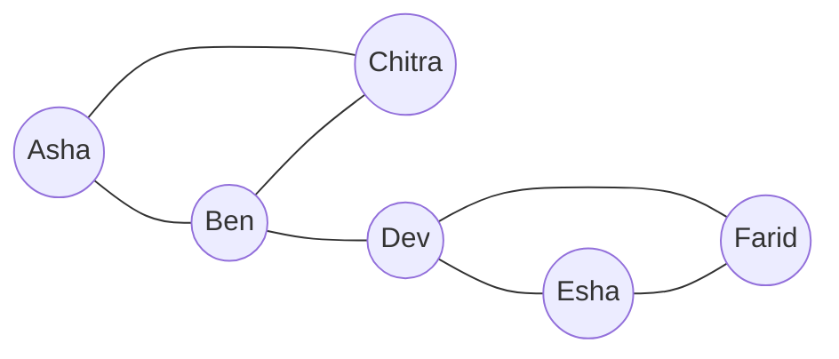

**In simple words:** a social network is a set of actors (people, accounts, companies) together with the relationships between them. Many real networks also show locality: if A knows B and C, then B and C are more likely to know each other. <Cite id="social-network-graphs-wiki-social-network" /> <Cite id="social-network-graphs-mmds-book" /> <Cite id="social-network-graphs-wiki-homophily" />

**As a graph.** Each actor is a node and each relationship is an edge. Edges may be undirected (friends) or directed (follows), and may carry weights (number of calls).

<Cite id="social-network-graphs-ibm-sna" loc="diagram" />

**Varieties of social networks.** <Cite id="social-network-graphs-wiki-sna" />

| Variety | Nodes | Edge means | Edge type |
|---|---|---|---|
| Friendship (Facebook) | People | Two people are friends | Undirected |
| Follower (X, Instagram) | Accounts | One follows the other | Directed |
| Telephone | Phone numbers | A call was made | Undirected, weighted |
| Email | Email addresses | An email was sent | Directed |
| Collaboration | Authors, actors | Worked together | Undirected, weighted |
| Several node types | Users, photos, tags | Uploaded, tagged | Joins different node types |

**Need for a social network graph.** A list of "who knows whom" is only rows of data. As a graph we can run graph algorithms on the whole structure:

1. Find **communities**: classmates, fan groups, fraud rings.
2. Find **influential** people who lie on many shortest paths.
3. **Recommend** friends: a friend of a friend is a missing triangle edge.
4. Target **advertising** at a community.
5. Study the **spread** of news or disease.
6. Detect **fake accounts** and spam by odd edge patterns.

<Cite id="social-network-graphs-ibm-sna" />

**Conclusion:** the graph model turns relationships into something we can measure and analyse.
