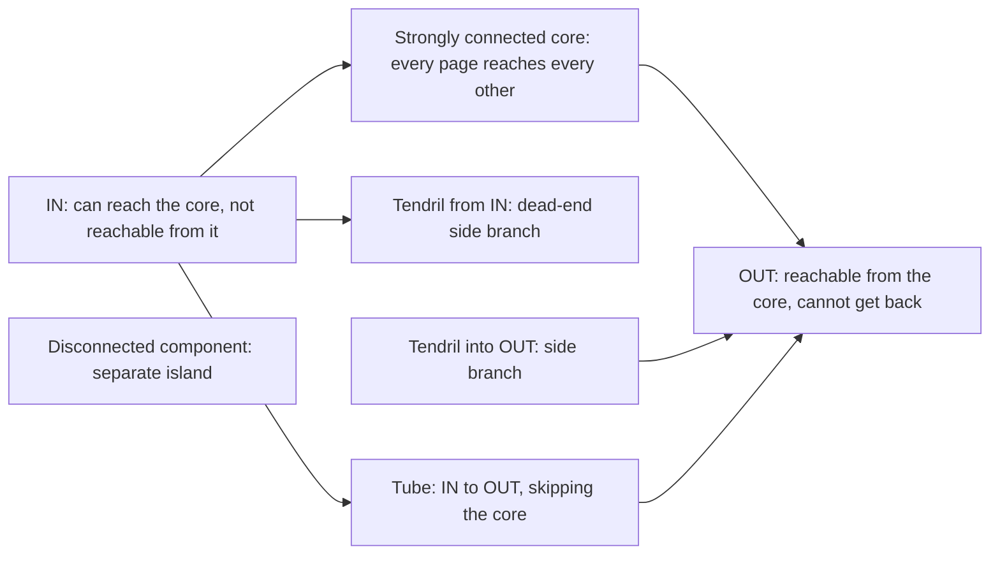

**In simple words:** web ek bahut bada directed graph hai: har page ek node aur har hyperlink ek directed edge. Studies mein mila ki ye random uljhan nahi hai, balki bow-tie shape ka hai. <Cite id="hadoop-ecosystem-mmds" loc="§5.1.3" /> <Cite id="pagerank-wiki-webgraph" />

Usual bow-tie pictures se redraw kiya gaya. <Cite id="pagerank-cs246-pagerank" loc="diagram" />

**Parts.**

- **Strongly connected core (SCC).** Pages ka bada set jisme har page links follow karke har dusre tak pahunch sakta hai. Ye web ka dil hai.
- **IN.** Wo pages jo core tak pahunch sakte hain par core se unhe nahi pahuncha ja sakta, jaise naya page jo popular pages ko link karta hai par use abhi koi link nahi karta.
- **OUT.** Wo pages jinhe core pahunch sakta hai par wo wapas nahi aa sakte, jaise company sites jinke links sirf unke apne pages ko jaate hain.
- **Tendrils.** IN se latke pages (IN se reachable, core tak nahi jaate) ya OUT mein jaate pages (core se reachable nahi).
- **Tubes.** IN se seedhe OUT tak ke paths jo core ko skip karte hain.
- **Disconnected components.** Chhote islands jinka main web se koi link path nahi.

**Ye kyun matter karta hai.** Rank sirf links ke saath behta hai. Isliye OUT aur dead-end tendrils mein rank jama hota hai ya leak hota hai, jabki IN ko kam milta hai. Yahi dead ends aur spider traps hain jinhe PageRank ko handle karna padta hai. <Cite id="pagerank-wiki-spidertrap" />

**Conclusion:** web bow-tie shape ka directed graph hai, aur uska structure decide karta hai ki rank kaise behta hai aur search engines use kaise crawl karte hain.
