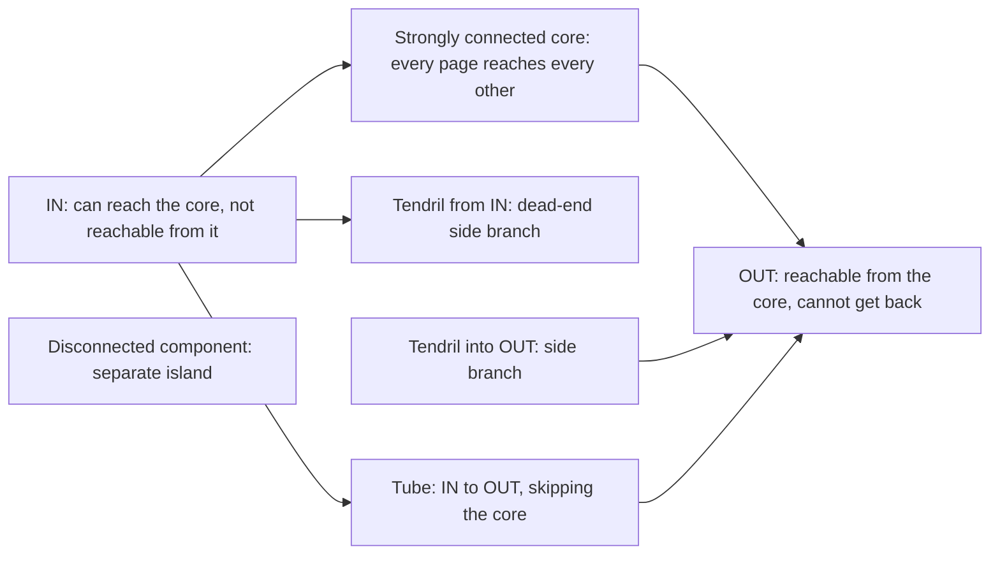

**In simple words:** the web is a very large directed graph: each page is a node and each hyperlink is a directed edge. Studies found that it is not a random tangle but has a bow-tie shape. <Cite id="hadoop-ecosystem-mmds" loc="§5.1.3" /> <Cite id="pagerank-wiki-webgraph" />

Redrawn from the usual bow-tie pictures. <Cite id="pagerank-cs246-pagerank" loc="diagram" />

**The parts.**

- **Strongly connected core (SCC).** A large set of pages in which every page can reach every other by following links. It is the heart of the web.
- **IN.** Pages that can reach the core but cannot be reached from it, such as a new page that links to popular pages nobody links to yet.
- **OUT.** Pages the core can reach but that cannot reach back, such as company sites whose links point only to their own pages.
- **Tendrils.** Pages hanging off IN (reachable from IN, not leading to the core) or leading into OUT (not reachable from the core).
- **Tubes.** Paths from IN straight to OUT that skip the core.
- **Disconnected components.** Small islands with no link path to or from the main web.

**Why it matters.** Rank can flow only along links. So in OUT and in dead-end tendrils rank piles up or leaks away, while IN receives little. These are the dead ends and spider traps that PageRank must handle. <Cite id="pagerank-wiki-spidertrap" />

**Conclusion:** the web is a directed graph with a bow-tie shape, and its structure decides how rank flows and how search engines crawl it.
