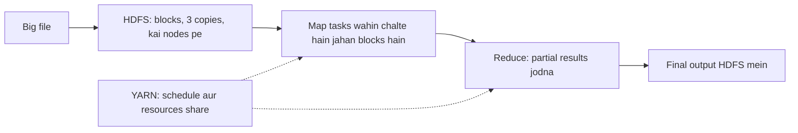

**In simple words:** big data itni badi hai ki ek computer na use store kar sakta hai, na jaldi process kar sakta hai. Hadoop ek open-source framework hai jo dono kaam bahut saare sasti machines (cluster) pe baant deta hai, taaki wo saath mein kaam karein. <Cite id="hadoop-ecosystem-gfg-hadoop-intro" /> <Cite id="hadoop-ecosystem-aws-hadoop" />

| Big data problem | Hadoop kaise handle karta hai |
|---|---|
| Ek disk ke liye data bahut zyada (volume) | **HDFS** files ko bade blocks (default 128 MB) mein kaat ke kai machines pe rakhta hai <Cite id="hadoop-ecosystem-apache-hdfs-design" /> |
| Machines baar baar fail hoti hain | HDFS har block ki 3 copies rakhta hai (replication), to ek machine fail hone pe kuch nahi khota |
| Processing bahut slow (velocity) | **MapReduce** program ko wahin bhejta hai jahan data hai, aur kai map tasks parallel chalte hain <Cite id="hadoop-ecosystem-dean2004" /> |
| Ek cluster pe kai jobs | **YARN** har job ko CPU aur memory deta hai aur schedule karta hai |
| Alag alag data types (variety) | HDFS koi bhi file rakh leta hai: text, logs, images, JSON |
| Cost | Sasti commodity hardware pe chalta hai, aur machines add karke grow kar sakte hain (scale out) |

**Key idea:** chhota program data ke paas le jaana, terabytes data ko program ke paas le jaane se sasta hai.

**Limitation:** MapReduce batch-type hai, chhote ya interactive jobs ke liye slow hai.

**Conclusion:** Hadoop storage (HDFS), processing (MapReduce) aur resource sharing (YARN) ko sasti clusters pe built-in fault tolerance ke saath solve karta hai.
