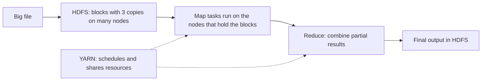

**In simple words:** big data is too large for one computer to store and too slow for one computer to process. Hadoop is an open-source framework that spreads both jobs over many cheap computers (a cluster) so they work together. <Cite id="hadoop-ecosystem-gfg-hadoop-intro" /> <Cite id="hadoop-ecosystem-aws-hadoop" />

| Big data problem | How Hadoop handles it |
|---|---|
| Too much data for one disk (volume) | **HDFS** cuts files into large blocks (128 MB by default) and stores them across many machines <Cite id="hadoop-ecosystem-apache-hdfs-design" /> |
| Machines fail often | HDFS keeps 3 copies of every block (replication), so a failed machine loses nothing |
| Processing is too slow (velocity) | **MapReduce** sends the program to the machines that hold the data and runs many map tasks in parallel <Cite id="hadoop-ecosystem-dean2004" /> |
| Many jobs share one cluster | **YARN** gives each job CPU and memory and schedules it |
| Different data types (variety) | HDFS stores any file: text, logs, images, JSON |
| Cost | Runs on cheap commodity hardware, and more machines can be added to grow (scale out) |

**Key idea:** moving a small program to the data is cheaper than moving terabytes of data to the program.

**Limitation:** MapReduce is batch-oriented and slow for small or interactive jobs.

**Conclusion:** Hadoop solves storage (HDFS), processing (MapReduce) and resource sharing (YARN) on cheap clusters with built-in fault tolerance.
