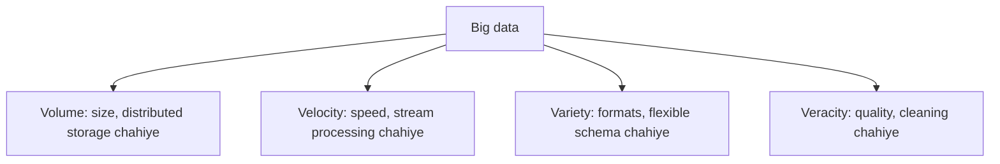

**In simple words:** big data matlab aisa data jo itna bada, tez ya alag alag type ka ho ki normal tools sambhal na payein. Classic four characteristics hain four Vs: **Volume, Velocity, Variety aur Veracity**. Kai books mein paanchva V, Value, bhi hota hai. <Cite id="big-data-intro-ibm" /> <Cite id="big-data-intro-gfg" />

1. **Volume (kitna).** Data ka size: terabytes se petabytes aur usse bhi zyada. *Example:* Facebook roz arbon users ki photos, posts aur likes collect karta hai. Itne size ke liye HDFS jaisa distributed storage chahiye.
2. **Velocity (kitni tez).** Data kitni speed se aata hai aur kitni jaldi process karna hai, aksar real time mein. *Example:* card transactions, sensor readings aur stock ticks jinhe seconds mein check karna hota hai. Iske liye stream processing chahiye.
3. **Variety (kitne type).** Data kai forms mein aata hai: structured (tables), semi-structured (JSON, XML, logs) aur unstructured (text, images, video). *Example:* hospital mein patient tables, doctor ke notes aur X-ray images. Fixed relational schema sab nahi rakh sakta.
4. **Veracity (kitna bharosemand).** Data noisy, incomplete, duplicate ya biased ho sakta hai. *Example:* fake reviews ya kharab sensors. Analysis pe bharosa karne se pehle cleaning aur validation chahiye.

| V | Kaunsa sawaal | Typical challenge |
|---|---|---|
| Volume | Kitna? | Storage |
| Velocity | Kitni tez? | Real-time processing |
| Variety | Kis type ka? | Formats ko jodna |
| Veracity | Kitna reliable? | Quality aur cleaning |

**Conclusion:** four Vs batate hain ki traditional databases kyun fail hote hain aur Hadoop, NoSQL aur stream tools kyun use hote hain.
