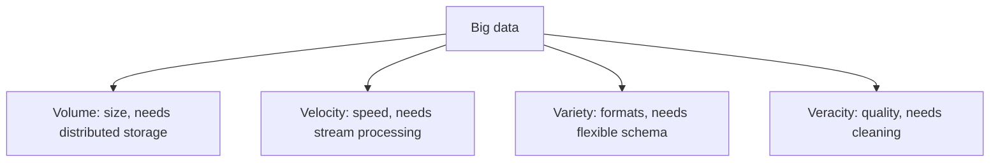

**In simple words:** big data means data so large, fast or varied that normal tools cannot handle it. The classic four characteristics are the four Vs: **Volume, Velocity, Variety and Veracity**. Many books add a fifth, Value. <Cite id="big-data-intro-ibm" /> <Cite id="big-data-intro-gfg" />

1. **Volume (how much).** The size of the data: terabytes to petabytes and more. *Example:* Facebook collects photos, posts and likes from billions of users every day. Such size needs distributed storage like HDFS.
2. **Velocity (how fast).** The speed at which data arrives and must be processed, often in real time. *Example:* card transactions, sensor readings and stock ticks that must be checked within seconds. This needs stream processing.
3. **Variety (how many kinds).** Data comes in many forms: structured (tables), semi-structured (JSON, XML, logs) and unstructured (text, images, video). *Example:* a hospital holds patient tables, doctor notes and X-ray images. A fixed relational schema cannot hold all of it.
4. **Veracity (how trustworthy).** Data can be noisy, incomplete, duplicated or biased. *Example:* fake reviews or faulty sensors. Cleaning and validating are needed before the analysis can be trusted.

| V | Question it answers | Typical challenge |
|---|---|---|
| Volume | How much? | Storage |
| Velocity | How fast? | Real-time processing |
| Variety | What kinds? | Integration of formats |
| Veracity | How reliable? | Quality and cleaning |

**Conclusion:** the four Vs explain why traditional databases fail and why Hadoop, NoSQL and stream tools are used.
