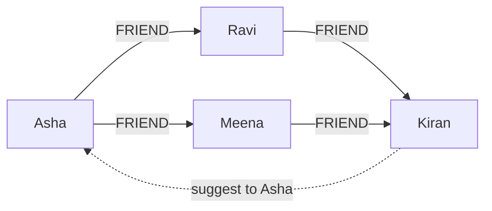

**In simple words:** graph store (graph database) data ko **nodes** (cheezein) aur **edges** (cheezon ke beech relationships) ki tarah rakhta hai, aur dono ke paas properties ho sakti hain. Links seedhe store hote hain, isliye relationship follow karna fast hai aur join nahi chahiye. Examples: Neo4j, Amazon Neptune. <Cite id="nosql-patterns-neo4j-model" /> <Cite id="nosql-patterns-gfg-graph" />

**Ye kyun zaroori hai:** relational database mein "friends of my friends" jaise sawaal ke liye bahut saare joins lagte hain, aur har extra hop se query aur slow hoti hai. Graph store mein har node seedha apne neighbours ko point karta hai, to ek hop ka cost lagbhag same rehta hai chahe poora database kitna bhi bada ho.

**Building blocks**

1. **Node:** ek entity, jaise Person, jiski properties name aur city jaisi hoti hain.
2. **Edge (relationship):** naam wala, direction wala link jaise FRIEND ya BOUGHT, jiski properties (jaise date) bhi ho sakti hain.
3. **Query:** graph pe ek pattern match hota hai, jaise Neo4j ki Cypher language mein. <Cite id="pyq-2024-05-ce-neo4j-cypher" />



**Example business problem: social network pe friend recommendation.** Company chahti hai ki user ko wo log suggest karein jinhe wo jaanta ho sakta hai. Query friends of friends dhundhti hai jo abhi friend nahi hain:

```text
MATCH (me:Person {name: "Asha"})-[:FRIEND]->(:Person)-[:FRIEND]->(s:Person)
WHERE NOT (me)-[:FRIEND]->(s) AND s <> me
RETURN s.name, count(*) AS mutual_friends
ORDER BY mutual_friends DESC
```

Kiran ke Asha ke saath 2 mutual friends hain, isliye wo pehle aata hai. SQL mein ye ek bahut badi friends table pe self-join hota, aur har extra hop pe dohrana padta. Yahi idea **fraud detection** (ek phone, address ya card share karne wale accounts ka ring), **route finding** aur **product recommendation** ko bhi solve karta hai. <Cite id="pyq-2024-05-ce-neo4j-fraud" />

| Point | Relational database | Graph store |
|---|---|---|
| Relationships | Foreign keys, query time pe joins | Edges ki tarah stored |
| Deep link queries | Slow, bahut joins | Fast traversal |
| Best for | Tabular, transactional data | Highly connected data |

**Limitations:** key-value ya document stores ke muqable kai servers pe failana mushkil hai, aur simple bulk data ke liye theek nahi.

**Conclusion:** graph store connected data ko naturally model karta hai, isliye recommendations aur fraud rings jaise relationship sawaalon ka jawab jaldi milta hai.
