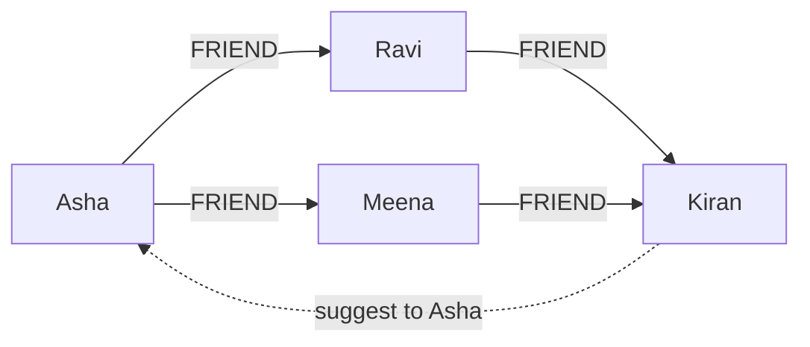

**In simple words:** a graph store (graph database) keeps data as **nodes** (things) and **edges** (relationships between things), and both can carry properties. The links are stored directly, so following a relationship is fast and needs no join. Examples: Neo4j, Amazon Neptune. <Cite id="nosql-patterns-neo4j-model" /> <Cite id="nosql-patterns-gfg-graph" />

**Why it is needed:** in a relational database, questions like "friends of my friends" need many joins, and each extra hop makes the query slower. In a graph store every node points straight to its neighbours, so a hop costs about the same however large the whole database is.

**Building blocks**

1. **Node:** an entity, for example a Person, with properties such as name and city.
2. **Edge (relationship):** a named, directed link such as FRIEND or BOUGHT, which can also have properties such as the date.
3. **Query:** a pattern is matched on the graph, for example in Neo4j's Cypher language. <Cite id="pyq-2024-05-ce-neo4j-cypher" />



**Example business problem: friend recommendation on a social network.** The company wants to suggest people a user may know. The query finds friends of friends who are not yet friends:

```text
MATCH (me:Person {name: "Asha"})-[:FRIEND]->(:Person)-[:FRIEND]->(s:Person)
WHERE NOT (me)-[:FRIEND]->(s) AND s <> me
RETURN s.name, count(*) AS mutual_friends
ORDER BY mutual_friends DESC
```

Kiran has 2 mutual friends with Asha, so he is ranked first. In SQL this would be a self-join on a huge friends table, repeated for every extra hop. The same idea solves **fraud detection** (accounts sharing a phone, address or card form a ring), **route finding** and **product recommendation**. <Cite id="pyq-2024-05-ce-neo4j-fraud" />

| Point | Relational database | Graph store |
|---|---|---|
| Relationships | Foreign keys, joins at query time | Stored as edges |
| Deep link queries | Slow, many joins | Fast traversal |
| Best for | Tabular, transactional data | Highly connected data |

**Limitations:** harder to spread over many servers than key-value or document stores, and a poor fit for simple bulk data.

**Conclusion:** a graph store models connected data naturally, so relationship questions such as recommendations and fraud rings are answered quickly.
