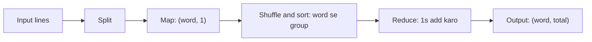

**In simple words:** word count batata hai ki text mein har word kitni baar aaya. **Map** har word ko pair (word, 1) bana deta hai. System **shuffle** aur sort karta hai taaki same words ek jagah milein, aur **reduce** har word ke 1s ko add karta hai. <Cite id="hadoop-ecosystem-mmds" loc="§2.2.1" /> <Cite id="hadoop-ecosystem-apache-mr-tutorial" />

**Pseudo code**

```text
map(key, line):                      # key = line number, line = text ki ek line
    for each word w in line:
        emit(w, 1)

reduce(word, counts):                # counts = is word ke 1s ki list
    total = 0
    for c in counts:
        total = total + c
    emit(word, total)
```



<Cite id="mapreduce-algorithms-gfg-dataflow" loc="diagram" />

<Sum>

<Given>

teen input lines: (1) `deer bear river`, (2) `car car river`, (3) `deer car bear`.

</Given>

<Find>

har word ka count.

</Find>

<Steps>

1. **Map.** Har line ek mapper ke paas jaati hai, jo har word ke liye (word, 1) emit karta hai:

   | Line | Map output |
   |---|---|
   | 1 | (deer,1) (bear,1) (river,1) |
   | 2 | (car,1) (car,1) (river,1) |
   | 3 | (deer,1) (car,1) (bear,1) |

2. **Shuffle and sort.** Same word ke saare pairs ek reducer ke paas aate hain aur key se sort hote hain:

   | Key | Values |
   |---|---|
   | bear | [1, 1] |
   | car | [1, 1, 1] |
   | deer | [1, 1] |
   | river | [1, 1] |

3. **Reduce.** Har key ki list add karo:

   | Key | Sum | Output |
   |---|---|---|
   | bear | 1 + 1 | (bear, 2) |
   | car | 1 + 1 + 1 | (car, 3) |
   | deer | 1 + 1 | (deer, 2) |
   | river | 1 + 1 | (river, 2) |

</Steps>

<Answer>

bear 2, car 3, deer 2, river 2.

</Answer>

<Box kind="verify">

Input mein $3 + 3 + 3 = 9$ words hain aur counts ka sum $2 + 3 + 2 + 2 = 9$ hai. Aankh se dobara gino: car line 2 mein do baar aur line 3 mein ek baar hai, to 3.

</Box>

</Sum>

**Optional combiner:** combiner har mapper ke output pe pehle reduce logic chalata hai (line 2 ke liye (car,2) milta hai), to network pe kam data jaata hai. <Cite id="hadoop-ecosystem-apache-mr-tutorial" />

**Conclusion:** word count MapReduce pattern dikhata hai: map key-value pairs banata hai, shuffle key se group karta hai, aur reduce har group ka summary deta hai.
