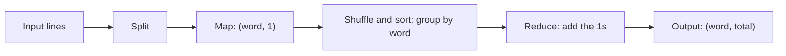

**In simple words:** word count tells how many times each word appears in the text. **Map** turns every word into a pair (word, 1). The system **shuffles** and sorts so equal words meet, and **reduce** adds the 1s for each word. <Cite id="hadoop-ecosystem-mmds" loc="§2.2.1" /> <Cite id="hadoop-ecosystem-apache-mr-tutorial" />

**Pseudo code**

```text
map(key, line):                      # key = line number, line = one line of text
    for each word w in line:
        emit(w, 1)

reduce(word, counts):                # counts = list of 1s for this word
    total = 0
    for c in counts:
        total = total + c
    emit(word, total)
```



<Cite id="mapreduce-algorithms-gfg-dataflow" loc="diagram" />

<Sum>

<Given>

three input lines: (1) `deer bear river`, (2) `car car river`, (3) `deer car bear`.

</Given>

<Find>

the count of each word.

</Find>

<Steps>

1. **Map.** Each line goes to one mapper, which emits (word, 1) for every word:

   | Line | Map output |
   |---|---|
   | 1 | (deer,1) (bear,1) (river,1) |
   | 2 | (car,1) (car,1) (river,1) |
   | 3 | (deer,1) (car,1) (bear,1) |

2. **Shuffle and sort.** All pairs with the same word are brought to one reducer and sorted by key:

   | Key | Values |
   |---|---|
   | bear | [1, 1] |
   | car | [1, 1, 1] |
   | deer | [1, 1] |
   | river | [1, 1] |

3. **Reduce.** Add the list for each key:

   | Key | Sum | Output |
   |---|---|---|
   | bear | 1 + 1 | (bear, 2) |
   | car | 1 + 1 + 1 | (car, 3) |
   | deer | 1 + 1 | (deer, 2) |
   | river | 1 + 1 | (river, 2) |

</Steps>

<Answer>

bear 2, car 3, deer 2, river 2.

</Answer>

<Box kind="verify">

The input has $3 + 3 + 3 = 9$ words and the counts add to $2 + 3 + 2 + 2 = 9$. Recounting by eye: car appears twice in line 2 and once in line 3, so 3.

</Box>

</Sum>

**Optional combiner:** a combiner runs the reduce logic on each mapper's output first (for line 2 it gives (car,2)), so less data crosses the network. <Cite id="hadoop-ecosystem-apache-mr-tutorial" />

**Conclusion:** word count shows the MapReduce pattern: map creates key-value pairs, the shuffle groups by key, and reduce summarises each group.
