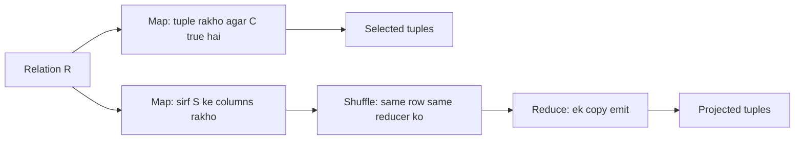

**In simple words:** relational algebra rows (tuples) wali table (relation) $R$ pe kaam karti hai. **Selection** $\sigma_C(R)$ sirf wo rows rakhta hai jo condition $C$ satisfy karti hain. **Projection** $\pi_S(R)$ sirf list $S$ ke columns rakhta hai aur duplicate rows hata deta hai. Dono MapReduce mein aasaan hain. <Cite id="mapreduce-algorithms-tp-relalg" /> <Cite id="hadoop-ecosystem-mmds" loc="§2.3.3 to §2.3.5" />

**Selection $\sigma_C(R)$**

- **Map:** $R$ ke har tuple $t$ pe $C$ test karo. Agar true hai to pair $(t, t)$ emit karo. Nahi to kuch emit nahi karo.
- **Reduce:** asal mein zaroorat nahi. Reduce function identity hai: jo milta hai wahi likh deta hai.

**Projection $\pi_S(R)$**

- **Map:** har tuple $t$ se sirf $S$ ke attributes wala $t'$ banao aur $(t', t')$ emit karo.
- **Reduce:** ek key $t'$ kai baar aa sakti hai (duplicates). List $[t', t', \dots, t']$ lo aur $(t', t')$ ko **sirf ek baar** emit karo. Isse duplicates hat jaate hain.

```text
-- Selection
map(t):    if C(t): emit(t, t)
reduce(t, values):   emit(t, t)

-- Projection
map(t):    t2 = t restricted to attributes S;  emit(t2, t2)
reduce(t2, values):  emit(t2, t2)         # sirf ek copy
```



<Sum>

<Given>

relation Student(ID, Name, Marks): (1, Asha, 56), (2, Ravi, 75), (3, Meena, 48), (4, Ravi, 69).

</Given>

<Find>

selection $\sigma_{Marks \geq 50}(R)$ aur projection $\pi_{Name}(R)$.

</Find>

<Steps>

1. **Selection map.** Har tuple pe $Marks \geq 50$ test karo:

   | Tuple | Marks $\geq$ 50? | Map output |
   |---|---|---|
   | (1, Asha, 56) | yes | ((1,Asha,56), (1,Asha,56)) |
   | (2, Ravi, 75) | yes | ((2,Ravi,75), (2,Ravi,75)) |
   | (3, Meena, 48) | no | kuch nahi |
   | (4, Ravi, 69) | yes | ((4,Ravi,69), (4,Ravi,69)) |

   Reduce teeno tuples ko jaise hain waise likh deta hai.
2. **Projection map.** Sirf Name rakho:

   | Tuple | Map output |
   |---|---|
   | (1, Asha, 56) | (Asha, Asha) |
   | (2, Ravi, 75) | (Ravi, Ravi) |
   | (3, Meena, 48) | (Meena, Meena) |
   | (4, Ravi, 69) | (Ravi, Ravi) |

3. **Shuffle aur reduce.** Key se group karo: Asha $\to$ [Asha], Meena $\to$ [Meena], Ravi $\to$ [Ravi, Ravi]. Reduce har key ko ek baar emit karta hai.

</Steps>

<Answer>

selection se (1, Asha, 56), (2, Ravi, 75), (4, Ravi, 69) milte hain. Projection se Asha, Meena, Ravi milte hain.

</Answer>

<Box kind="verify">

Selection: 4 rows, sirf Meena ka 48 fail hota hai, to 3 rows bachti hain. Projection: 4 names jisme Ravi repeat hai, to 3 distinct names, jo SQL `SELECT DISTINCT Name` ke barabar hai.

</Box>

</Sum>

**Note:** practice mein selection ko shuffle nahi chahiye, to ye map-only job hai. Projection ko reduce step sirf duplicates hatane ke liye chahiye. <Cite id="mapreduce-algorithms-gfg-relalg" />

**Conclusion:** selection map mein filter karta hai, aur projection map mein columns kaatta hai aur reduce mein duplicates hatata hai.
