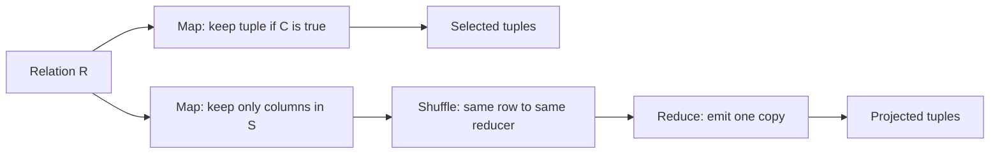

**In simple words:** relational algebra works on a table (relation) $R$ of rows (tuples). **Selection** $\sigma_C(R)$ keeps only the rows that satisfy a condition $C$. **Projection** $\pi_S(R)$ keeps only the columns in the list $S$ and removes duplicate rows. Both are easy in MapReduce. <Cite id="mapreduce-algorithms-tp-relalg" /> <Cite id="hadoop-ecosystem-mmds" loc="§2.3.3 to §2.3.5" />

**Selection $\sigma_C(R)$**

- **Map:** for each tuple $t$ in $R$, test $C$. If it is true, emit the pair $(t, t)$. Otherwise emit nothing.
- **Reduce:** not really needed. The reduce function is the identity: it just writes out what it receives.

**Projection $\pi_S(R)$**

- **Map:** for each tuple $t$, build $t'$ with only the attributes in $S$ and emit $(t', t')$.
- **Reduce:** one key $t'$ may arrive many times (duplicates). Take the list $[t', t', \dots, t']$ and emit $(t', t')$ **once**. This removes duplicates.

```text
-- Selection
map(t):    if C(t): emit(t, t)
reduce(t, values):   emit(t, t)

-- Projection
map(t):    t2 = t restricted to attributes S;  emit(t2, t2)
reduce(t2, values):  emit(t2, t2)         # one copy only
```



<Sum>

<Given>

relation Student(ID, Name, Marks): (1, Asha, 56), (2, Ravi, 75), (3, Meena, 48), (4, Ravi, 69).

</Given>

<Find>

selection $\sigma_{Marks \geq 50}(R)$ and projection $\pi_{Name}(R)$.

</Find>

<Steps>

1. **Selection map.** Test $Marks \geq 50$ on each tuple:

   | Tuple | Marks $\geq$ 50? | Map output |
   |---|---|---|
   | (1, Asha, 56) | yes | ((1,Asha,56), (1,Asha,56)) |
   | (2, Ravi, 75) | yes | ((2,Ravi,75), (2,Ravi,75)) |
   | (3, Meena, 48) | no | nothing |
   | (4, Ravi, 69) | yes | ((4,Ravi,69), (4,Ravi,69)) |

   Reduce writes the three tuples unchanged.
2. **Projection map.** Keep only Name:

   | Tuple | Map output |
   |---|---|
   | (1, Asha, 56) | (Asha, Asha) |
   | (2, Ravi, 75) | (Ravi, Ravi) |
   | (3, Meena, 48) | (Meena, Meena) |
   | (4, Ravi, 69) | (Ravi, Ravi) |

3. **Shuffle and reduce.** Group by key: Asha $\to$ [Asha], Meena $\to$ [Meena], Ravi $\to$ [Ravi, Ravi]. Reduce emits each key once.

</Steps>

<Answer>

selection gives (1, Asha, 56), (2, Ravi, 75), (4, Ravi, 69). Projection gives Asha, Meena, Ravi.

</Answer>

<Box kind="verify">

Selection: 4 rows, only Meena's 48 fails, so 3 rows remain. Projection: 4 names with Ravi repeated gives 3 distinct names, the same as SQL `SELECT DISTINCT Name`.

</Box>

</Sum>

**Note:** selection needs no shuffle in practice, so it is a map-only job. Projection needs the reduce step only to remove duplicates. <Cite id="mapreduce-algorithms-gfg-relalg" />

**Conclusion:** selection filters in map, and projection trims columns in map and de-duplicates in reduce.
