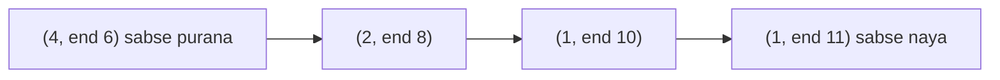

**In simple words:** DGIM (Datar, Gionis, Indyk, Motwani, 2002) estimate karta hai ki **last $N$ bits mein kitne 1s hain**. Saare $N$ bits store karna mehnga hai, isliye wo kuch **buckets** rakhta hai jo 1s ke groups ko summarise karte hain, aur sirf lagbhag $O(\log^2 N)$ bits memory lagti hai. Answer zyada se zyada 50 percent galat ho sakta hai. <Cite id="stream-counting-mmds-home" loc="§4.6" /> <Cite id="stream-counting-wiki-dsm" />

**Bucket kya hai:** ek pair (size, end time). Size us bucket mein 1s ki sankhya hai aur hamesha power of 2 hoti hai (1, 2, 4, 8, ...). End time uske sabse recent 1 ki position hai.

**Rules**

1. Bucket ka end hamesha 1 hota hai. 0 kabhi bucket shuru ya khatam nahi karta.
2. Koi position do buckets mein nahi hoti, buckets overlap nahi karte.
3. Har size ke **ek ya do buckets** hote hain. Teesra aa jaye to us size ke do sabse purane buckets ko merge karke double size ka ek bucket banao (uska end time naya wala end hota hai).
4. Peeche jaate hue sizes kabhi kam nahi hote.
5. Jab bucket ka end time window se bahar chala jaye to use hata do.

**Har naye bit pe update:** agar 0 hai to sirf window se bahar buckets hatao. Agar 1 hai to bucket (1, now) jodo, phir size 1 se upar jaate hue rule 3 theek karo.

**Estimate:** saare buckets ke sizes jodo, lekin sabse purane (last) bucket ka sirf **aadha** gino, kyunki pata nahi uske kitne 1s abhi window mein hain.

<Sum>

<Given>

stream (positions 1 se 12): `1 0 1 1 0 1 1 1 0 1 1 0`, window $N = 8$.

</Given>

<Find>

position 12 ke baad buckets aur last 8 bits mein 1s ka estimate.

</Find>

<Steps>

1. Buckets (size, end time) likhe hain, sabse naya pehle.

   | Position | Bit | Update ke baad buckets |
   |---|---|---|
   | 1 | 1 | (1,1) |
   | 2 | 0 | (1,1) |
   | 3 | 1 | (1,3) (1,1) |
   | 4 | 1 | (1,4) (1,3) (1,1): size 1 ke teen, do purane merge karke (2,3). Result (1,4) (2,3) |
   | 5 | 0 | (1,4) (2,3) |
   | 6 | 1 | (1,6) (1,4) (2,3) |
   | 7 | 1 | (1,7) (1,6) (1,4) (2,3): (1,6) aur (1,4) merge karke (2,6). Result (1,7) (2,6) (2,3) |
   | 8 | 1 | (1,8) (1,7) (2,6) (2,3) |
   | 9 | 0 | koi change nahi; window positions 2 se 9 hai, kuch expire nahi hota |
   | 10 | 1 | (1,10) (1,8) (1,7) (2,6) (2,3): (1,8),(1,7) merge karke (2,8). Ab size 2 ke teen: (2,6),(2,3) merge karke (4,6). Result (1,10) (2,8) (4,6) |
   | 11 | 1 | (1,11) (1,10) (2,8) (4,6) |
   | 12 | 0 | koi change nahi; window positions 5 se 12 hai |

2. Position 12 pe buckets (1,11), (1,10), (2,8), (4,6) hain. Sab end times $\geq 5$ hain, to koi expire nahi hota.
3. Sabse purane ko chhodkar sizes ka sum $= 1 + 1 + 2 = 4$. Sabse purane ka aadha $= 4/2 = 2$.
4. Estimate $= 4 + 2 = 6$.

</Steps>

<Answer>

last 8 bits mein 1s ka estimate $= 6$.

</Answer>

<Box kind="verify">

Last 8 bits (positions 5 se 12) `0 1 1 1 0 1 1 0` hain, jinme **5** ones hain. Estimate 6, 1 se galat hai, yaani 20 percent error, jo 50 percent bound ke andar hai. Stream mein total ones $= 8$ (positions 1, 3, 4, 6, 7, 8, 10, 11), aur buckets mein $1 + 1 + 2 + 4 = 8$ ones hain, to koi 1 kho nahi gaya.

</Box>

</Sum>

**Error kyun bounded hai:** sirf sabse purana bucket uncertain hai, aur error us bucket ke size ka zyada se zyada aadha hota hai. Sabse purana bucket true count ke lagbhag aadhe se bada nahi hota, isliye estimate 50 percent ke andar rehta hai. **Conclusion:** DGIM "last $N$ bits mein kitne 1s" ka jawab logarithmic memory aur bounded error ke saath deta hai.
