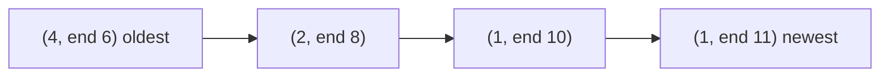

**In simple words:** DGIM (Datar, Gionis, Indyk, Motwani, 2002) estimates **how many 1s are in the last $N$ bits** of a stream. Storing all $N$ bits is too costly, so it keeps a few **buckets** that summarise groups of 1s, using only about $O(\log^2 N)$ bits. The answer is off by at most 50 percent. <Cite id="stream-counting-mmds-home" loc="§4.6" /> <Cite id="stream-counting-wiki-dsm" />

**What a bucket is:** a pair (size, end time). Size is the number of 1s in it and is always a power of 2 (1, 2, 4, 8, ...). The end time is the position of its most recent 1.

**Rules**

1. The end of a bucket is always a 1. A 0 never starts or ends a bucket.
2. No position belongs to two buckets, and buckets do not overlap.
3. There are **one or two buckets of each size**. If a third appears, merge the two oldest of that size into one bucket of double size (its end time is the newer end).
4. Sizes never decrease going back in time.
5. Drop a bucket when its end time falls outside the window.

**Update for each new bit:** if it is 0, only drop out-of-window buckets. If it is 1, add a bucket (1, now), then fix rule 3 starting from size 1 and moving up.

**Estimate:** add the sizes of all buckets, but count only **half** of the oldest (last) bucket, because we do not know how many of its 1s are still inside the window.

<Sum>

<Given>

stream (positions 1 to 12): `1 0 1 1 0 1 1 1 0 1 1 0`, window $N = 8$.

</Given>

<Find>

the buckets after position 12 and the estimated number of 1s in the last 8 bits.

</Find>

<Steps>

1. Buckets are written (size, end time), newest first.

   | Position | Bit | Buckets after the update |
   |---|---|---|
   | 1 | 1 | (1,1) |
   | 2 | 0 | (1,1) |
   | 3 | 1 | (1,3) (1,1) |
   | 4 | 1 | (1,4) (1,3) (1,1): three of size 1, merge the two oldest into (2,3). Result (1,4) (2,3) |
   | 5 | 0 | (1,4) (2,3) |
   | 6 | 1 | (1,6) (1,4) (2,3) |
   | 7 | 1 | (1,7) (1,6) (1,4) (2,3): merge (1,6) and (1,4) into (2,6). Result (1,7) (2,6) (2,3) |
   | 8 | 1 | (1,8) (1,7) (2,6) (2,3) |
   | 9 | 0 | no change; the window is positions 2 to 9, nothing expires |
   | 10 | 1 | (1,10) (1,8) (1,7) (2,6) (2,3): merge (1,8),(1,7) into (2,8). Now three of size 2: merge (2,6),(2,3) into (4,6). Result (1,10) (2,8) (4,6) |
   | 11 | 1 | (1,11) (1,10) (2,8) (4,6) |
   | 12 | 0 | no change; the window is positions 5 to 12 |

2. At position 12 the buckets are (1,11), (1,10), (2,8), (4,6). All end times are $\geq 5$, so none expires.
3. Sum of sizes except the oldest $= 1 + 1 + 2 = 4$. Half of the oldest $= 4/2 = 2$.
4. Estimate $= 4 + 2 = 6$.

</Steps>

<Answer>

estimated number of 1s in the last 8 bits $= 6$.

</Answer>

<Box kind="verify">

The last 8 bits (positions 5 to 12) are `0 1 1 1 0 1 1 0`, which hold **5** ones. The estimate 6 is off by 1, an error of 20 percent, inside the 50 percent bound. Total ones in the stream $= 8$ (positions 1, 3, 4, 6, 7, 8, 10, 11), and the buckets hold $1 + 1 + 2 + 4 = 8$ ones, so no 1 was lost.

</Box>

</Sum>

**Why the error is bounded:** only the oldest bucket is uncertain, and the error is at most half of its size. The oldest bucket is never bigger than about half of the true count, so the estimate is within 50 percent. **Conclusion:** DGIM answers "how many 1s in the last $N$ bits" with logarithmic memory and a bounded error.
