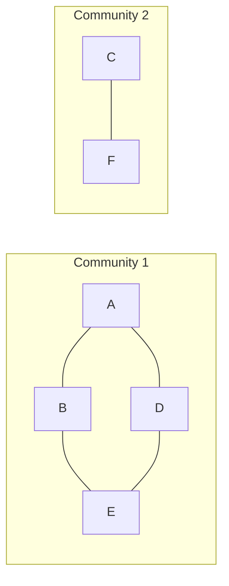

**In simple words:** Girvan-Newman algorithm communities ko aise dhundhta hai ki groups ke beech ke **bridge** edges hata deta hai. Bridge bahut saare shortest paths pe hota hai, isliye uski **edge betweenness** high hoti hai. Sabse high wali edge hatao, phir se calculate karo, aur dohrao. Jab graph toot jaye, to pieces communities hain. <Cite id="social-network-graphs-girvan-newman2002" /> <Cite id="social-network-graphs-wiki-girvan-newman" />

**Edge betweenness** kisi edge ki wo sankhya hai jitne shortest paths (sab node pairs ke beech) us edge se guzarte hain. Agar kisi pair ke kai shortest paths hain, to har path ek fraction (1 bhaag paths ki sankhya) ginta hai.

**Steps**

1. Har edge ki betweenness nikalo.
2. Sabse high betweenness wali edge hatao.
3. Bachi edges ke liye dobara nikalo aur tab tak dohrao jab tak graph hisson mein na toot jaye.

<Sum>

<Given>

graph ki edges A-B, B-C, A-D, B-E, C-F, D-E, E-F. Ye do squares hain (A-B-E-D aur B-C-F-E) jo edge B-E share karte hain.

</Given>

<Find>

communities.

</Find>

<Steps>

1. **Sab edges ki betweenness** (15 node pairs). Jaise A-F ke 3 shortest paths hain lambai 3 ke (A-B-E-F, A-D-E-F, A-B-C-F), to har path apni edges ko 1/3 deta hai. Saare pairs jodne par:

   | Edge | Kaun se pairs use karte hain | Betweenness |
   |---|---|---|
   | A-B | A-B, A-C, A-E (1/2), B-D (1/2), A-F (2/3), C-D (1/3) | 4 |
   | B-C | A-B ka mirror image | 4 |
   | D-E | A-B ka mirror image | 4 |
   | E-F | A-B ka mirror image | 4 |
   | B-E | B-E, A-E (1/2), C-E (1/2), B-D (1/2), B-F (1/2), A-F (1/3), C-D (1/3) | 11/3, lagbhag 3.67 |
   | A-D | A-D, A-E (1/2), B-D (1/2), A-F (1/3), C-D (1/3) | 8/3, lagbhag 2.67 |
   | C-F | A-D ka mirror image | 8/3, lagbhag 2.67 |

2. **Sabse high hatao.** Chaar edges 4 pe tie hain. Tie kisi bhi tarah todi ja sakti hai; **B-C** hatao. Graph B-E ke through connected rehta hai.
3. **Dobara calculate karo** bachi 6 edges pe:

   | Edge | A-B | A-D | B-E | D-E | E-F | C-F |
   |---|---|---|---|---|---|---|
   | Betweenness | 3 | 3 | 5 | 5 | 8 | 5 |

   E-F \{C, F\} aur \{A, B, D, E\} ke beech ka har pair carry karti hai, yaani $2 \times 4 = 8$ paths.
4. **E-F hatao** (8). Ab graph do hisson mein toot jaata hai.

</Steps>

<Answer>

do communities: **\{A, B, D, E\}** aur **\{C, F\}**.

</Answer>

<Box kind="verify">

Check 1: pehle round ki saari betweenness ka sum, sab 15 pairs ke shortest-path lengths ke sum ke barabar hona chahiye, jo $1+2+1+2+3+1+2+1+2+3+2+1+1+2+1 = 25$ hai. Values deti hain $4+4+4+4+\tfrac{11}{3}+\tfrac{8}{3}+\tfrac{8}{3} = 16 + 9 = 25$.

Check 2: symmetry se, pehle A-B ya D-E hatane par mirror result \{B, C, E, F\} aur \{A, D\} milta hai, aur pehle E-F hatane par bhi \{A, B, D, E\} aur \{C, F\} hi milta hai.

</Box>

</Sum>

**Note:** algorithm aur aage split kar sakta hai. Wo ek hierarchy banata hai, aur cut wahan chuna jaata hai jahan groups ka matlab banta ho. Yahan do groups pehla split hai. <Cite id="social-network-graphs-gfg-girvan-newman" /> <Cite id="social-network-graphs-wiki-betweenness" />

**Conclusion:** sabse high betweenness wali edges B-C aur E-F hatane se communities \{A, B, D, E\} aur \{C, F\} milti hain.
