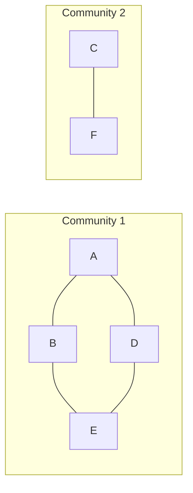

**In simple words:** the Girvan-Newman algorithm finds communities by removing the edges that act as **bridges** between groups. A bridge lies on many shortest paths, so it has high **edge betweenness**. Remove the highest one, recompute, and repeat. When the graph splits, the pieces are communities. <Cite id="social-network-graphs-girvan-newman2002" /> <Cite id="social-network-graphs-wiki-girvan-newman" />

**Edge betweenness** of an edge is the number of shortest paths between all node pairs that pass through it. If a pair has several shortest paths, each path counts as a fraction (1 divided by the number of paths).

**Steps**

1. Compute the betweenness of every edge.
2. Remove the edge with the highest value.
3. Recompute for the remaining edges and repeat until the graph breaks into parts.

<Sum>

<Given>

graph with edges A-B, B-C, A-D, B-E, C-F, D-E, E-F. It is two squares (A-B-E-D and B-C-F-E) sharing the edge B-E.

</Given>

<Find>

the communities.

</Find>

<Steps>

1. **Betweenness of all edges** (15 node pairs). For example, A-F has 3 shortest paths of length 3 (A-B-E-F, A-D-E-F, A-B-C-F), so each gives 1/3 to its edges. Adding every pair:

   | Edge | Pairs that use it | Betweenness |
   |---|---|---|
   | A-B | A-B, A-C, A-E (1/2), B-D (1/2), A-F (2/3), C-D (1/3) | 4 |
   | B-C | mirror image of A-B | 4 |
   | D-E | mirror image of A-B | 4 |
   | E-F | mirror image of A-B | 4 |
   | B-E | B-E, A-E (1/2), C-E (1/2), B-D (1/2), B-F (1/2), A-F (1/3), C-D (1/3) | 11/3, about 3.67 |
   | A-D | A-D, A-E (1/2), B-D (1/2), A-F (1/3), C-D (1/3) | 8/3, about 2.67 |
   | C-F | mirror image of A-D | 8/3, about 2.67 |

2. **Remove the highest.** Four edges tie at 4. A tie may be broken either way; remove **B-C**. The graph stays connected through B-E.
3. **Recompute** on the remaining 6 edges:

   | Edge | A-B | A-D | B-E | D-E | E-F | C-F |
   |---|---|---|---|---|---|---|
   | Betweenness | 3 | 3 | 5 | 5 | 8 | 5 |

   E-F carries every pair between \{C, F\} and \{A, B, D, E\}, which is $2 \times 4 = 8$ paths.
4. **Remove E-F** (8). The graph now splits into two parts.

</Steps>

<Answer>

two communities: **\{A, B, D, E\}** and **\{C, F\}**.

</Answer>

<Box kind="verify">

Check 1: the sum of all first-round betweenness values must equal the sum of shortest-path lengths over all 15 pairs, which is $1+2+1+2+3+1+2+1+2+3+2+1+1+2+1 = 25$. The values give $4+4+4+4+\tfrac{11}{3}+\tfrac{8}{3}+\tfrac{8}{3} = 16 + 9 = 25$.

Check 2: by symmetry, removing A-B or D-E first gives the mirror result \{B, C, E, F\} and \{A, D\}, and removing E-F first also leads to \{A, B, D, E\} and \{C, F\}.

</Box>

</Sum>

**Note:** the algorithm can continue to split further. It builds a hierarchy, and the cut is chosen where the groups make sense. Here two groups is the first split. <Cite id="social-network-graphs-gfg-girvan-newman" /> <Cite id="social-network-graphs-wiki-betweenness" />

**Conclusion:** removing the highest-betweenness edges B-C and E-F leaves communities \{A, B, D, E\} and \{C, F\}.
