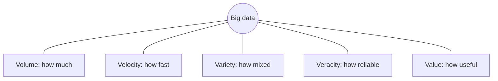

**In simple words:** big data wo data hai jo itna bada, itni tezi se aane wala aur itna mixed hota hai ki ek normal computer aur normal database ise handle nahi kar paate. Isse sambhalne ke liye bahut saare computers ek saath (cluster) chahiye. <Cite id="big-data-intro-wiki" /> <Cite id="big-data-intro-ibm" />

**Ye kyun zaroori hai:** phones, websites, sensors aur cameras har second data banate hain. Usme kaam ke jawab chhupe hote hain (customer kya khareedega, kaunsi machine kharab hogi), lekin tabhi milte hain jab hum data ko store aur process kar sakein.

**Characteristics (the V's).** Pehle teen classic hain; veracity aur value baad mein jode gaye. <Cite id="big-data-intro-gfg" /> <Cite id="big-data-intro-av" />

| V | Meaning | Example |
|---|---|---|
| **Volume** | Data ki matra: terabytes se petabytes | Facebook photos aur posts |
| **Velocity** | Data kitni tezi se aata hai aur process hona chahiye | Stock ticks, sensor readings |
| **Variety** | Bahut formats: tables, text, images, video, logs | Tweets, CCTV video, bank tables |
| **Veracity** | Data kitna sahi aur saaf hai | Fake reviews, noisy sensors |
| **Value** | Data se milne wala kaam ka result | Better product recommendations |

<Cite id="big-data-intro-gfg" loc="diagram" />

**Applications:** social media analysis, banks mein fraud detection, online shops mein recommendations, traffic aur weather prediction.

**Conclusion:** big data ko uske 5 V's se describe karte hain, aur inhi ki wajah se use distributed storage aur processing (jaise Hadoop) chahiye.

Exam mein English mein likho: "Big data is data that is too large, fast and varied for traditional systems, characterised by volume, velocity, variety, veracity and value."
